# Architecture

This document covers how the repo evaluates a Microsoft Foundry toolbox: its components, how a run flows through them, the
data they exchange, and the reasons behind the design.

For setup, see [getting-started.md](getting-started.md) (the sample deployment) or
[existing-environment.md](existing-environment.md) (your own project). Spans and queries are in [telemetry.md](telemetry.md).

## 1. Evaluation paths

The repo tests a toolbox at two levels. *Tests* call the toolbox directly; *evals* go through an agent connected to it.

| Path | Entry point | Calls | Checks | Output |
| --- | --- | --- | --- | --- |
| Tool tests | `python -m tooltests.run` | Toolbox MCP endpoint (Streamable HTTP, JSON-RPC) | Tool listing and definitions, results (assertions), error outcomes, auth status codes, latency | `results/tool-tests/run-*.json` |
| Agent evals, deterministic | `python -m evals.run_agent_evals` | Prompt agent through the Responses API | Expected tool calls and arguments (optionally ordered), forbidden calls, response regexes, latency | `results/agent-evals/run-*.json` |
| Agent evals, ASSERT | `python scripts/run_assert.py <config>` | `assert-ai`, which drives the agent through `evals/foundry_agent/target.py` and judges it with an LLM | Violation rate for one behavior per config (for example ungrounded figures, raw error replies) | `results/assert/results/<suite>/<run>/` |
| Agent evals, Foundry evaluators | `python -m evals.run_cloud_eval` | Foundry's evaluation service, which judges an agent run's stored responses, or calls the agent itself (`--target`) | LLM evaluators per turn (this repo's tool use and grounded adherence, and Foundry's built-in intent resolution), and how often they agree with the deterministic checks | `results/cloud-evals/run-*.json` |

The agent-eval paths complement each other:

- The deterministic runner checks exact calls and parameters, which the judges do not.
- ASSERT judges open-ended behavior, which regexes cannot, with test cases it generates for one behavior at a time.
- Foundry's evaluation service judges the same turns the deterministic runner scored, server-side, with no judge to
  host, with this repo's evaluators and a built-in one. They rate general qualities rather than one behavior, so the
  report compares their verdicts with the checks.
- The deterministic runner and ASSERT call the agent through the same target code, so a platform quirk shows up the
  same way in each.

The deterministic and ASSERT paths also work with toolboxes whose connections pass the signed-in user's identity to the
MCP server; see [entra.md](entra.md).

## 2. System context

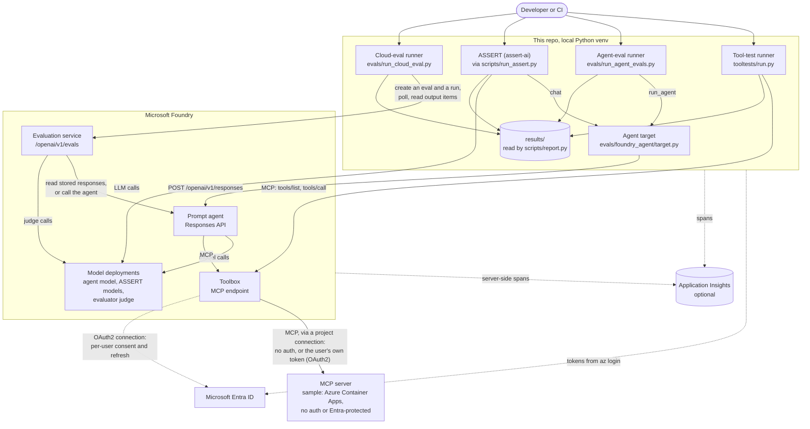

The runners run locally, or in GitHub Actions for the daily live runs ([live-ci.md](live-ci.md)), against live Azure
resources; no eval code runs inside Azure. Resource identifiers come from the git-ignored `.env` (in CI, from the `live`
environment's secrets), and tracked files contain none.

## 3. Components

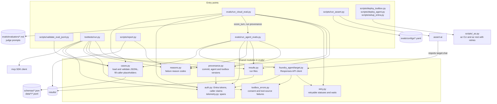

| Module | Responsibility |
| --- | --- |
| `tooltests/run.py` | MCP client for the toolbox: one session per run, outcome classification, assertions, latency percentiles, reconnects |
| `evals/run_agent_evals.py` | Runs multi-turn conversations against the agent, each later turn continuing the previous turn's stored response (or replaying the text), optionally several times over, and scores every turn |
| `evals/run_cloud_eval.py` | Has Foundry's evaluation service judge the agent with this repo's evaluators (judge prompts in `evals/evaluators/`, registered in the project's evaluator catalog) and built-in ones: creates or reuses an evaluation, runs it over an agent run's stored responses or, with `--target`, over the first turns of case files, polls the run, and turns each output item into a verdict per turn beside that turn's deterministic result |
| `evals/foundry_agent/target.py` | Calls the agent through the Responses API with retries, continuing a stored response when given one, reads `mcp_call` and `message` output items, detects platform aborts and turns the agent never ran (`abort_reason`), and emits agent and tool spans. Its `chat()` is ASSERT's callable target: it continues the stored response behind a transcript and logs what served each call |
| `evals/cases.py` | Finds, parses and validates JSONL cases (JSON Schema plus cross-field and cross-file rules), and fills `{{caller.*}}` placeholders |
| `evals/auth.py` | Entra tokens from `az login`, cached per scope and refreshed 5 minutes before expiry; the signed-in user's claims for placeholders |
| `evals/toolbox_errors.py` | Recognizes toolbox errors caused by a tool source (consent needed, or the source failed) and prints consent links to the console, the only place they appear |
| `evals/reasons.py` | Failure reason codes and what each means, shared by the runners and `report.py` |
| `evals/results.py` | Writes each run of any runner to a new `run-<UTC timestamp>.json`; a run finishing in the same second as another waits for the next second, so no run overwrites another and names sort in run order. Also groups a repeated run's results by turn for pass rates, flaky turns and extra calls, and tallies cloud verdicts per evaluator and how the judge agrees with the checks |
| `evals/retry.py` | The HTTP statuses worth retrying and the wait before each retry (`Retry-After`, up to 60 s, else 5, 10, 20, 30 s), shared by the target and the cloud-eval runner |
| `evals/provenance.py` | Records what a run ran against: the commit and whether the working tree had changes, each toolbox's default version, and for agent runs the agent version and its model. Versions come only from `FOUNDRY_PROJECT_ENDPOINT`; what can't be read is null, and a failed lookup never fails a run |
| `evals/telemetry.py` | `span()` helper and the optional App Insights exporter; does nothing without a connection string |
| `scripts/run_assert.py` | Runs `assert-ai run` from the repo root with artifacts under `results/assert`, and writes the run's `provenance.json` |
| `scripts/report.py` | Markdown reports and baseline diffs for tool, agent, cloud and ASSERT runs: pass rates, failures grouped by reason, what tool, agent and cloud runs ran against and what of that changed, cloud verdicts per evaluator and how the judge agrees with the checks, ASSERT violations with the judge's justifications and the errors of cases it couldn't score |
| `scripts/validate_eval_jsonl.py` | Validates case files without running them |
| `scripts/deploy_toolbox.py`, `deploy_agent.py`, `_az.py` | Create the connection (no auth, OAuth2 or UserEntraToken), toolbox version and agent version through `az rest`; for OAuth2, also the client secret and redirect URI on the client app |
| `scripts/setup_entra.py` | Registers the Entra apps for the Entra sample through Microsoft Graph: the API app (scope, app roles, your role assignments) and the OAuth client app |
| `sample-mcp-server/` | Synthetic MCP server, packaged as a container image: three tools, plus Entra token validation (`entra_auth.py`), region filtering and `whoami` with `AUTH_MODE=entra` |
| `tests/` | Offline unit tests: no Azure access or `.env` needed |
| `.github/workflows/ci.yml` | CI on pushes to `main` and pull requests: dependency check, byte-compile, case validation and unit tests on Ubuntu (Python 3.11 and 3.14) and Windows (3.14). Offline only |
| `.github/workflows/live.yml` | Daily and manual live runs of the sample tool tests and agent evals, then Foundry's evaluators on the agent's replies, as a managed identity signed in through OIDC; reports go to the job summary and result files stay on the runner ([live-ci.md](live-ci.md)) |
| `.github/dependabot.yml` | Weekly update PRs for the pinned packages in both `requirements.txt` files, the sample server's base image and the CI actions |

## 4. Cases and results

### Case formats

Cases are JSONL, one object per line, validated against `schemas/tool-test.schema.json` and
`schemas/agent-eval.schema.json`.

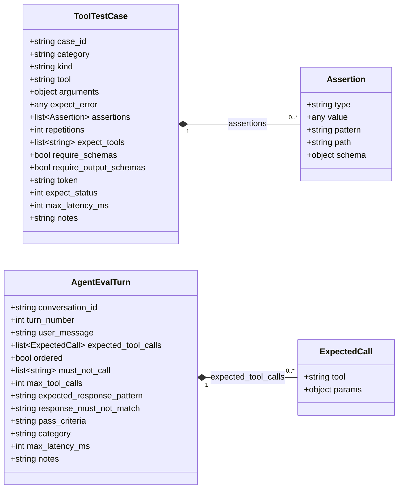

Each tool-test `kind` uses its own fields. The validator flags fields the kind ignores.

| `kind` | Required | Optional |
| --- | --- | --- |
| `call` (default) | `tool`, `arguments` | `expect_error` (`false`, `true` or `"tool"`, `"protocol"`), `assertions`, `repetitions`, `max_latency_ms` |
| `list` | `expect_tools` | `require_schemas`, `require_output_schemas`, `max_latency_ms` |
| `auth` | `token` (`invalid` or `none`), `expect_status` | none |

Assertion types:

- `contains` (`value`, case-insensitive)
- `regex` (`pattern`)
- `json_path_equals` (`path`, `value`)
- `json_path_exists` (`path`)
- `schema` (`schema`)

For agent turns, `expected_tool_calls` is required but may be empty, for example when only the reply matters.

Any string in either case type may contain `{{caller.oid}}`, `{{caller.tid}}`, `{{caller.name}}` or `{{caller.username}}`.
The runners fill them from the signed-in user's Foundry token before the run, regex-escaping values in regex fields, so
identity checks need no real user in the files ([entra.md](entra.md#caller-placeholders)).

### Validation

Both runners validate every case before running any, and `scripts/validate_eval_jsonl.py` performs the same checks
without running them.

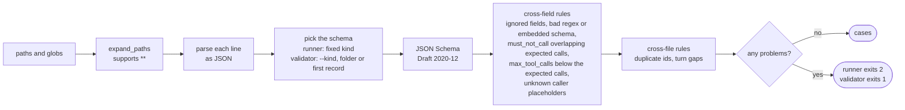

The runners then fill caller placeholders. They read the token's claims only if a case uses a placeholder, and a
placeholder whose claim the token lacks exits 2.

### Result files

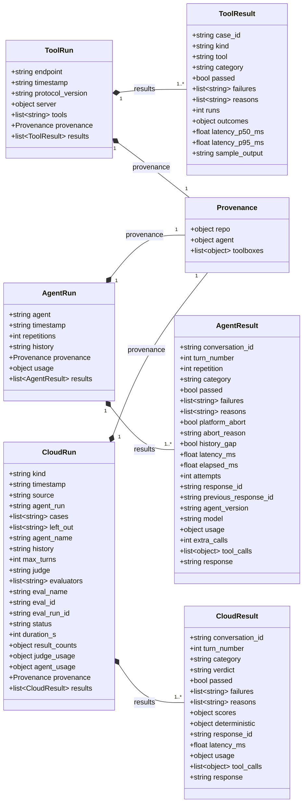

- `outcomes` counts outcomes across repetitions.
- An agent run made with `--repetitions N` records `repetitions`, and each result its `repetition`: one result per turn
  and run. Runs recorded before repetitions existed lack both and count as one run.
- `extra_calls` counts a turn's tool calls beyond the number it expects. It is null when the turn doesn't check its
  calls (`pass_criteria` `response_matches`) or no calls are known (the request raised, or the agent never ran).
- `reasons` runs parallel to `failures`: `reasons[i]` is the code for `failures[i]`, described in `evals/reasons.py`.
  Reports group failures by it, and spans carry the distinct codes as `eval.reasons`.
- `latency_ms` is the final HTTP attempt. `elapsed_ms` is the whole request: token fetches, every attempt and the
  waits between them. Both, and `attempts`, are null when a turn raised.
- `response_id`, `agent_version`, `model` and `usage` (input, output and total tokens) come from the agent's response,
  and are null when the request failed with an HTTP error. The run's `usage` sums its turns. `usage` is what the service
  meters for the whole turn, tool-calling steps included: a run's totals matched the model deployment's `InputTokens` and
  `OutputTokens` metrics in Azure Monitor exactly.
- `provenance` says what the run ran against: `repo` (`commit`, and `dirty` when the working tree had uncommitted or
  untracked changes), `toolboxes` (`name` and `version`, the default version that the consumer endpoint serves) and, for
  agent runs, `agent` (`name`, the `version` that served the most turns, and its `model`). Versions are read from
  `FOUNDRY_PROJECT_ENDPOINT` after the run, never from another host, so the Foundry token goes nowhere new; a version
  that can't be read is null.
- `abort_reason` is `tool_error`, `tool_call_failed`, `consent_required` or `tool_listing_failed` when `platform_abort`
  is true.
- `history` is how later turns carried the conversation, `chain` or `replay` ([Multi-turn
  conversations](#multi-turn-conversations)); agent runs recorded before it existed replayed text. A result's
  `previous_response_id` is the stored response the turn continued, null for a first turn and when replaying.
- A cloud run's `source` is `responses` or `target` ([§8](#8-foundry-evaluators)). A `responses` run judged the stored
  responses of the agent run `agent_run`, the evaluators seeing up to `max_turns` turns of each conversation; it keeps
  that run's `history` and `provenance`, since that run produced the replies. A `target` run had Foundry call
  `agent_name` with the first turn of each conversation in `cases`, lists the later turns it left out in `left_out`, and
  reads `provenance` after the run.
- A cloud result's `verdict` is `pass`, `fail`, `error`, `skipped` or `not_judged`, and `passed` is true for `pass`
  and `skipped`. `scores` holds each evaluator's `status`, `score`, `label`, `threshold`, `passed` and `reason`.
  `deterministic` (`passed`, `failures`, `reasons`) is the same turn's checks: copied from the agent run, or run on
  Foundry's reply for a `target` run. `judge_usage` sums the judge's tokens. `agent_usage` (null for a `responses` run)
    sums the agent's, and only `target` results have `latency_ms` and `usage`. `report_url` links to the run in the
    portal and names the project.
- `report.py` matches results to a baseline by `case_id`, or by conversation and turn, and lists what the run ran
  against that differs from the baseline's. An unknown version doesn't count as a change. A turn that ran several times
  counts once: it passed only if every run passed, its latency is the median over its runs, and a failure that recurs
  over its runs is listed once with the number of runs it occurred in.

## 5. Tool tests

### Run sequence

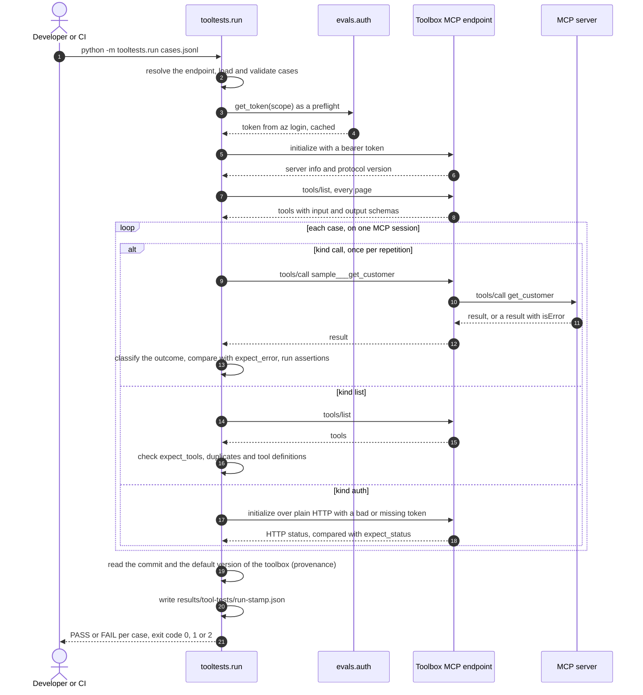

- Before each timed request the runner calls `auth.get_token`, which serves the cached token, so a token refresh never
  counts toward a call's latency.
- `auth` cases use a separate HTTP client, because the MCP session cannot send a bad token.
- Every request carries a W3C `traceparent` header, so the toolbox's own spans join the case's trace
  ([§10](#10-telemetry)).

### Outcomes

Every request ends in exactly one outcome:

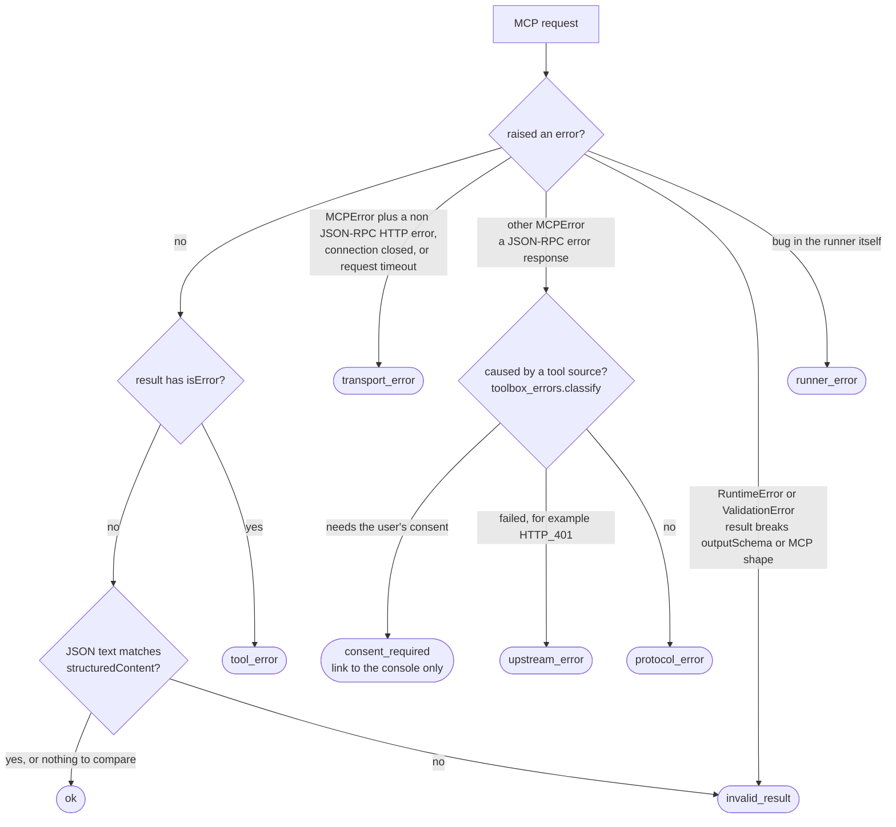

A run passes when both of these hold:

1. Its outcome is the expected one. `expect_error` maps to the expected outcome:
   - `false` → `ok`
   - `true` or `"tool"` → `tool_error`
   - `"protocol"` → `protocol_error`
2. Every assertion holds.

Assertions run only on the expected outcome, so they can check error text as well.

- `consent_required`, `upstream_error`, `invalid_result`, `transport_error` and `runner_error` always fail.
- A tool with an `outputSchema` must return `structuredContent` that matches it; the MCP SDK checks this when the call
  returns and raises otherwise. The runner then compares the JSON text, the part a model reads, with the
  `structuredContent` (`content_mismatch`). It skips text that isn't JSON, such as a summary for the model, and the SDK's
  `{"result": ...}` wrapper around a result that isn't an object. Both problems are `invalid_result`.
- A case passes when every repetition passes and none exceeds `max_latency_ms`.
- The results record p50 and p95 latency across repetitions.
- Each failure records a reason: the unexpected outcome, `unexpected_success` (an expected error didn't happen),
  `assertion` or `latency`. Listing and auth cases add `missing_tool`, `duplicate_tool`, `tool_definition` and
  `auth_status`, and cases left unrun after a lost session get `not_run`.

### Session lifecycle

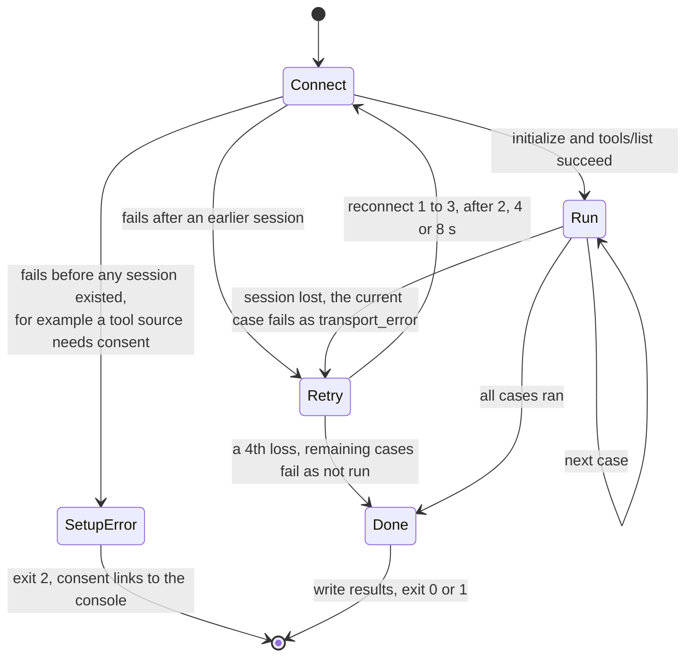

The HTTP client has no read timeout. A read timeout inside an MCP POST tears down the whole session, so the MCP-level
request timeout (`--timeout`, default 60 s) bounds each request instead and reports `transport_error`. Connection
attempts are retried by the HTTP transport (3 retries). Each case's result prints as soon as it finishes, so a run that
waits out timeouts still shows progress.

## 6. Agent evals

### One agent turn

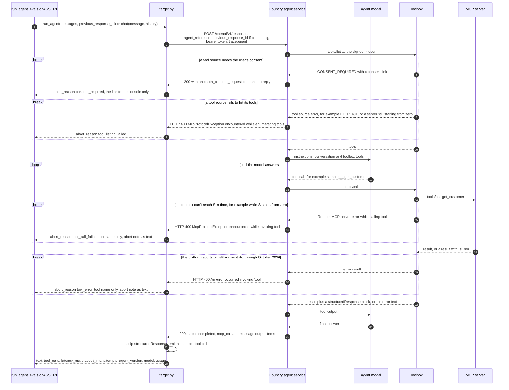

Tool errors reach the model as text. The `mcp_call` item of a failed call reports `status: completed` and `error: null`,
with the error message as its output (`Error executing tool <tool>: ...` from the sample server), so only the reply shows
how the agent handled it. Cases check the reply with `expected_response_pattern` and `response_must_not_match`, and the
`tool_error_handling` ASSERT config judges it.

Through October 2026 the service didn't hand tool errors to the model: an `isError` result failed the whole Responses
call with HTTP 400, so the agent never got a chance to recover. The target still handles that response. It reports
`platform_abort` with `abort_reason` `tool_error`, the tool name parsed from the error and no arguments.

When the agent can't run at all, because a tool source needs the user's consent or can't list its tools, the target sets
`abort_reason` to `consent_required` or `tool_listing_failed` and notes `[AGENT NOT RUN: ...]` instead of a reply. Such
turns fail before any check runs, so a check like `must_not_call` can't pass on a turn that never happened.

When the toolbox can't make the call the model chose, the service fails the whole call with HTTP 400
`McpProtocolException encountered while invoking tool`. The target reports `platform_abort` with `abort_reason`
`tool_call_failed`, the tool name parsed from the error and no arguments. This and a listing failure are what the first
requests get while an MCP server that scaled to zero is starting ([§13](#13-platform-behaviors-the-design-handles)).

### Retries

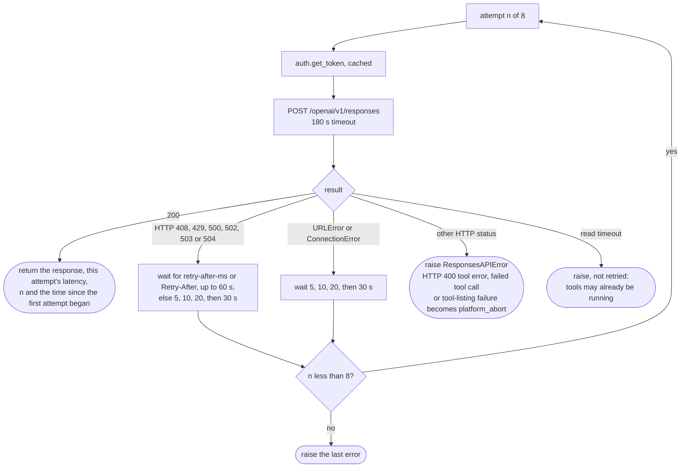

`latency_ms` covers the final attempt only, so token fetches and retry waits are excluded; `max_latency_ms` checks it.
`elapsed_ms` covers the whole call: token fetches, every attempt and the waits between them. `attempts` records how many
tries the turn needed, and the console shows the elapsed time of turns that needed more than one.

### Scoring a turn

| Check | Applies when | Rule | Failure reason |
| --- | --- | --- | --- |
| `expected_tool_calls` | `pass_criteria` is `tool_called_correctly` or `both` | See the matching rules below | `missing_call`, `wrong_arguments` or `wrong_order` |
| `must_not_call` | always | None of these tools was called | `forbidden_call` |
| `max_tool_calls` | always, if set | No more tool calls than this, expected or not | `extra_calls` |
| `expected_response_pattern` | `pass_criteria` is `response_matches` or `both`, and the platform didn't abort | Case-insensitive regex search over the whole reply | `response_mismatch` |
| `response_must_not_match` | the platform didn't abort | The reply does not match | `forbidden_response` |
| `max_latency_ms` | always, if set | Latency of the final HTTP attempt | `latency` |

A turn the agent never ran (`abort_reason` `consent_required` or `tool_listing_failed`) fails with its note and the abort
reason as its failure reason, and no other check runs. A turn the platform aborted on a tool error or a failed tool call
fails as `platform_abort`. Its tool calls, `must_not_call` and `max_tool_calls` are still checked, but the reply checks are skipped, because the user
got no reply. A turn whose request raised fails with `runner_error`.

How `expected_tool_calls` are matched:

- Each expected call must match its own call: the same name, and every listed param equal. Strings compare
  case-insensitively, and a `re:` prefix makes a param a regex search. Other values compare as JSON, so `true` doesn't
  equal `1`, while `1` equals `1.0`.
- Extra params are allowed, and so are extra calls unless `max_tool_calls` caps them. Every result records its
  `extra_calls`, and reports total them, so an agent that calls more than it needs shows up even when its turns pass.
  `max_tool_calls` counts every call, expected or not; a value below the number of expected calls is a case error.
- Without `ordered`, expected calls are paired with calls so that as many as possible match. A broad `re:` param can't
  take the only call that a stricter expected call matches.
- With `ordered`, the matches must occur in order.
- A platform-aborted call matches on name only, because its arguments are unknown.
- An unmatched expected call fails as `wrong_order` when a matching call was made out of order (`ordered` only), as
  `wrong_arguments` when the tool was called but with other arguments (the message lists them), and as `missing_call`
  otherwise.

### Multi-turn conversations

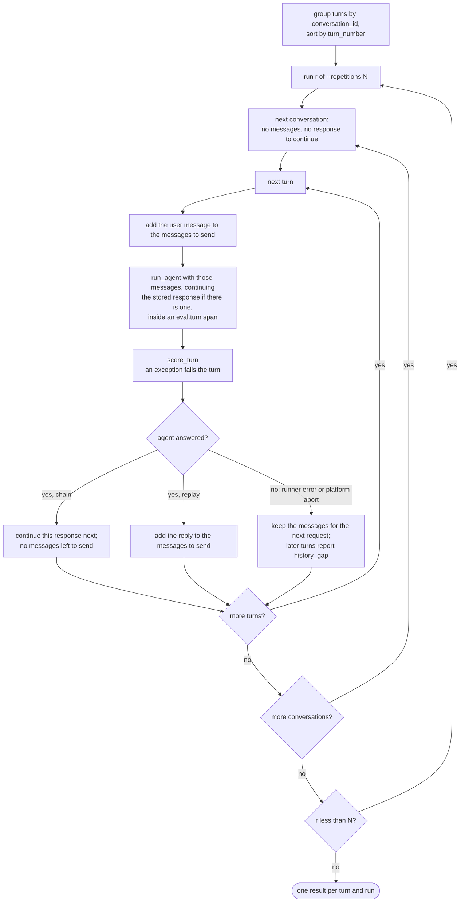

`--history`, else `FOUNDRY_AGENT_HISTORY`, sets how later turns carry the conversation:

- `chain` (the default): a later turn sends only its new user message, with `previous_response_id` naming the stored
  response that answered the turn before. The service continues from everything that response held, earlier tool calls
  and their results included, as it does for a user in a chat. The request must still name the agent
  (`agent_reference`); the service rejects a continuation without it. A turn that got no answer leaves nothing new to
  continue, so its user message goes again with the next turn's, after the last answered response. A reply without a
  `response_id` is added as text instead.
- `replay`: every request sends the conversation as text, every user message plus the replies received so far. Earlier
  tool results are not sent, so the agent has to call the tools again for data it fetched before, or answers without
  it. Runs recorded before chaining existed replayed. Each earlier reply goes as an assistant message with
  `output_text` content: Foundry stores a plain-string reply as `input_text`, which its evaluators reject
  ([§8](#8-foundry-evaluators)).

The sample suite's `c-recall` tells them apart: turn 1 looks up Contoso, and turn 2 asks, without a new lookup, for its
contract value, which only the earlier tool result holds. Chained, the agent quoted the record's 1,250,000 USD in 4 of 4
runs. Replayed, it never had the value: in 2 of 4 runs it said so and offered a lookup, and in the other 2 it made one
up ($5,000,000 and $2,400,000).

### Repetitions

An agent answers the same prompt differently from run to run, so one run can't tell a reliable turn from a lucky one.
`--repetitions N` runs every conversation N times, each from an empty history. It runs all conversations, then all of
them again, so a brief platform problem doesn't fail every run of one conversation. A turn passes only if every run
passed (pass^N), and that decides the exit code, the report's totals and categories, and regressions against a baseline.
The console and reports add:

- pass@1: the mean share of runs that passed, per turn
- pass@N: the share of turns that passed at least once
- pass^N: the share of turns that passed every run
- the flaky turns: those that passed some runs but not all

Reason counts stay per turn: a turn that failed `missing_call` in two of three runs counts once.

## 7. ASSERT

[ASSERT](https://commandline.microsoft.com/assert-written-intent-executable-evals/) (`assert-ai`) turns a written behavior
into generated test cases, runs them against the agent, and has an LLM judge each transcript. Each config in
`evals/configs/` covers one behavior.

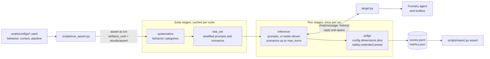

ASSERT's own model calls go through LiteLLM to `azure/<deployment>`:

- They include category generation, test generation, the tester that plays the user, and the judge.
- They use `AZURE_API_BASE`, with Entra auth when `ASSERT_AZURE_USE_AAD=1`.
- The judge needs a large `max_tokens` (24000) for a reasoning model.

Completed stages are cached, so a new run reuses the suite's categories and test set.

If the agent never ran (missing consent, or its tools couldn't be listed), `chat()` raises `AgentNotRun`. ASSERT records
that as a target error and leaves it unscored, so a setup problem isn't judged as a behavior violation. A `tool_error`
abort still returns its note, for the judge to see.

ASSERT gives `chat()` the transcript so far and no conversation ID, so the target chains by transcript. For each reply it
returns, it remembers the transcript up to and including that reply, and the reply's stored response. A later turn
whose transcript starts with a remembered one continues that response (`previous_response_id`) and sends only the
messages after it. Any other transcript is sent as text: a first turn, one that follows a failed reply, or one cached
by an earlier process. ASSERT passes each reply back as the target returned it; the comparison ignores surrounding
whitespace. `run_assert.py --history replay` (or `FOUNDRY_AGENT_HISTORY=replay`) sends every transcript as text.

The wrapper has the target log each agent call to a temporary file: the response, the stored response it continued,
the agent version, the model and tokens. After a run that called the agent, it writes the run's `provenance.json`
from that log: the `agent`, its `history` mode, `provenance` as in the run files, the agent calls (`requests`), how many
continued a stored response (`continued`) and their total `usage`. `continued` shows whether chaining took effect: it
stays 0 if every transcript went as text. A rerun that only reuses cached transcripts calls no agent and keeps the
file it has. Inference is cached by run name, so compare chain and replay under different run names.

```text
results/assert/results/<suite>/
  taxonomy.json, test_set.jsonl, ...   suite stages, reused by later runs
  <run>/                               for example baseline
    inference_set.jsonl                transcripts with per-turn trace data
    scores.jsonl, metrics.json         judge verdicts and metrics
    manifest.json, config.yaml         stage status and the resolved config
    provenance.json                    what the run ran against, written by run_assert.py
```

`report.py assert` reads `scores.jsonl` for the violation rate per dimension and the judge's justification for each
violation, `inference_set.jsonl` for the target error behind each case the judge couldn't score, and
`provenance.json` for what the run ran against and what changed since the baseline.

### How the judge sees tool calls

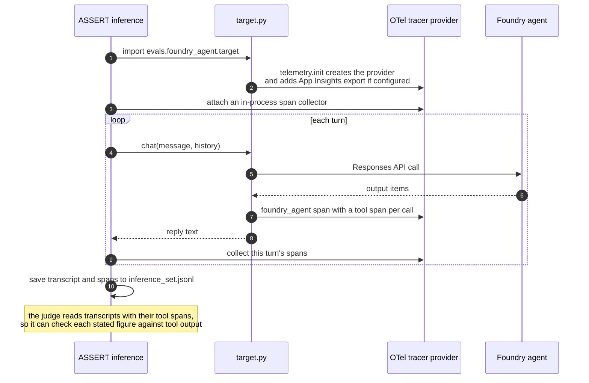

## 8. Foundry evaluators

`evals/run_cloud_eval.py` has Foundry's evaluation service judge the agent with this repo's evaluators and Foundry's
built-in ones, through the project's OpenAI-compatible evals API (`<FOUNDRY_PROJECT_ENDPOINT>/openai/v1/evals`, no
`api-version`). The judging runs in Foundry; the runner registers this repo's evaluators in the project's evaluator
catalog, creates or reuses an evaluation, starts a run, waits for it and reads its output items.

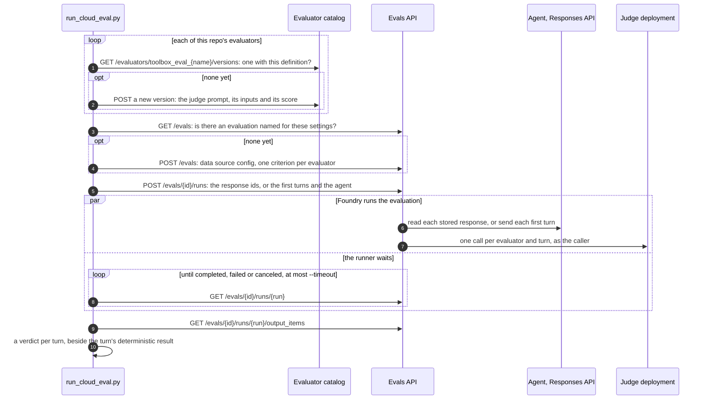

| | Stored responses (default) | `--target CASES` |
| --- | --- | --- |
| What is judged | Each turn of an agent run (the one given, else the newest), read by its `response_id`; the agent isn't called again | Foundry's own call to the agent (`--agent`) with the first turn of each conversation |
| What the evaluators see | Up to `--max-turns` turns of the conversation, the judged one included (default: the run's longest conversation); a chained run's earlier turns come with their tool calls and results | That turn only. Later turns are left out, because a target run can't continue a conversation |
| Data source | Evaluation: `azure_ai_source`, scenario `responses`. Run: `azure_ai_responses`, retrieving each response with `max_num_turns` | Evaluation: a `custom` item schema (`query`, `case`) plus the sample schema. Run: `azure_ai_target_completions`, sending `{{item.query}}` to an `azure_ai_agent` target |
| Evaluator inputs | This repo's evaluators: `query` from `{{item.query_history_list}}` (the agent's instructions and the earlier turns with their tool calls and results, then the user's message), `response` from `{{sample.output_items}}` and `tool_definitions` from `{{item.tool_definitions}}`. Built-in evaluators: found by the service | `query` from `{{item.query}}`, `response` from `{{sample.output_items}}`, and for this repo's evaluators and built-in `tool_*` ones `tool_definitions` from `{{sample.tool_definitions}}` |
| Deterministic result | Copied from the agent run | `score_turn` on Foundry's reply and its tool calls |
| Agent tokens and latency | In the agent run | Per turn, from the output item |

Each evaluator is a criterion `{"type": "azure_ai_evaluator"}` run with the `--judge` deployment, else
`FOUNDRY_EVAL_JUDGE_DEPLOYMENT`, else `gpt-4-1-mini`: `evaluator_name` `builtin.<name>` for a built-in evaluator, and
for this repo's `toolbox_eval_<name>` at its catalog `evaluator_version`, with a threshold of 3. The defaults:

| Evaluator | Scale | Fails a turn when |
| --- | --- | --- |
| `tool_use` (this repo's) | 1 to 5, passing from 3 | the turn misses a tool call the request needed, makes one it didn't need, or passes wrong arguments. A right call whose result is an error, such as no customer with that ID, counts as right; the reply isn't judged |
| `grounded_adherence` (this repo's) | 1 to 5, passing from 3 | a fact in the reply comes from no tool result of this turn or an earlier one, or the reply strays from the agent's instructions, or it neither answers the request nor says plainly what isn't available |
| `intent_resolution` (built-in) | 1 to 5, passing from 3 | the reply doesn't resolve what the user wanted |

This repo's evaluators are prompt evaluators: a judge prompt (`evals/evaluators/tool_use.md` and
`grounded_adherence.md`) gets the conversation, the turn's reply with its tool calls and results, and the agent's tool
definitions, and answers with a reason, then a score. Before each run, the runner looks in the project's evaluator
catalog (`<FOUNDRY_PROJECT_ENDPOINT>/evaluators/toolbox_eval_<name>/versions?api-version=v1`) for a version whose
definition (the prompt, its inputs and its score) is the repo's, and registers a new version if none is. Registering
is a preview feature, which a request opts in to with the header `Foundry-Features: Evaluations=V1Preview`. The
evaluation names the version, so a changed prompt gets a new evaluation, and the runs of each prompt stay together. The
run file keeps the versions (`evaluator_versions`) and nothing else from the catalog, whose replies also name the
account, the project and who registered the version.

They replace the defaults before them, the built-in `task_adherence` and `tool_call_accuracy`, which failed correct
turns ([§13](#13-platform-behaviors-the-design-handles)). They see the earlier turns with their tool calls and results;
`tool_use` counts a right call that returns an error as right; and `grounded_adherence` accepts a figure from an earlier
turn's tool result but fails one the agent made up. `--evaluators task_adherence,intent_resolution,tool_call_accuracy`
runs the old defaults.

The prompts were calibrated on 11 synthetic turns built from real ones, each with an expected verdict per evaluator: a
recalled figure, and the same figure made up, with chained and with replayed history; a made-up price after a tool
error; a quote given without a call; a lookup of the wrong customer; a figure the user gave; a misspelled name with no
retry; a redundant call; and a lookup by ID. The prompts in the repo matched every expected verdict on each of their
last calibration runs, two or three per prompt. The judge, `gpt-4.1-mini`, needed two things: the reason before the
score in its answer, or it sometimes scored against its own reasoning; and, for `tool_use`, the instruction to score
the calls only, with a user's "don't look anything up" meaning no call is needed, or the reply's faults lowered the
score. The judge varies from run to run, so check a changed prompt over several runs.

The evaluation is named for its settings, `toolbox-eval-<source>-<hash of its definition>`, and later runs with the same
settings reuse it, so the portal lists them together. The judge makes one call per evaluator and turn; when it shares a
model deployment with the agent, the two share its rate limit, so run one job at a time. Foundry makes those calls as
the caller, who needs Foundry User on the Foundry resource: with the role on the project only, each call fails with
`PermissionDenied` and every turn is an `error`. The same role covers registering this repo's evaluators. Each turn
gets the first of these verdicts that applies:

1. `not_judged`: the turn has no stored response, the run returned no output item for it, or the service couldn't read
   its stored response.
2. `error`, reason `agent_error`: Foundry's call to the agent failed (`--target`).
3. `fail`: an evaluator failed the turn. Each such evaluator is a reason; evaluators that couldn't judge the turn are
   listed too, as `evaluator_error`.
4. `error`, reason `evaluator_error`: an evaluator couldn't judge the turn.
5. `pass`: an evaluator passed it.
6. `skipped`: every evaluator found itself not applicable.
7. `not_judged`: no evaluator returned a result.

A turn passes on `pass` or `skipped`, and the runner exits 0 only when every turn passed; with `--fail-on unjudged`, as
live CI runs it, only `error` and `not_judged` turns make it exit 1. `report.py cloud` sets each verdict against the
same turn's deterministic result: how often the judge and the checks agree, and which turns only one of them failed.

On the sample suite (November 2026, judge `gpt-4-1-mini`), the old defaults agreed with the checks on 9 of 12 turns of a
chained run, and every disagreement was a correct turn the judge failed: both tool-error turns on `tool_call_accuracy`,
and the recall turn of `c-recall` on `task_adherence` ([§13](#13-platform-behaviors-the-design-handles)). Judging those
12 turns took about 160 s and 93,000 judge tokens. With `--target`, 8 of the 10 first turns passed, with the same two
disagreements. The current defaults passed all 12 turns, in about 130 s and 81,000 judge tokens, and all 10 first
turns with `--target`. On a replayed `c-recall` run, `grounded_adherence` failed the three replies that made up a
contract value (score 2) and passed the three that said it wasn't available.

## 9. Authentication and configuration

### Tokens

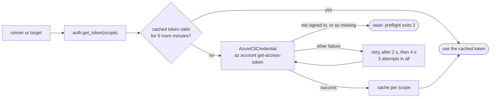

| Caller | Credential | Audience |
| --- | --- | --- |
| Tool runner, agent target | `evals.auth` (AzureCliCredential, cached, thread-safe) | `https://ai.azure.com/.default`; the tool runner can take `token_scope` from `--config` |
| Live CI | `azure/login` signs `az` in as a managed identity with GitHub's OIDC token, so the runners' AzureCliCredential works unchanged ([live-ci.md](live-ci.md)) | `https://ai.azure.com/.default`, fetched right after sign-in, before the OIDC token expires |
| Caller placeholders | `auth.caller_claims` reads the claims of that same cached token, without a signature check | None: no extra token |
| ASSERT model calls | assert-ai's Entra auth (`ASSERT_AZURE_USE_AAD=1`) | Azure OpenAI at `AZURE_API_BASE` |
| App Insights export | AzureCliCredential if `APPLICATIONINSIGHTS_USE_AAD=1`, else the connection string's key | App Insights ingestion |
| Deploy scripts | `az rest` | Azure Resource Manager (connection), `https://ai.azure.com` (toolbox, agent), Microsoft Graph (`setup_entra.py`, and the OAuth client's secret and redirect URI) |
| Toolbox to the sample MCP server | The connection's `authType: None` | Unauthenticated sample server |
| Toolbox to the Entra sample server | The connection's `authType: OAuth2`: the consenting user's token, refreshed with `offline_access` | `api://<api-app-id>/user_impersonation`, validated by the server |

### Toolbox endpoint

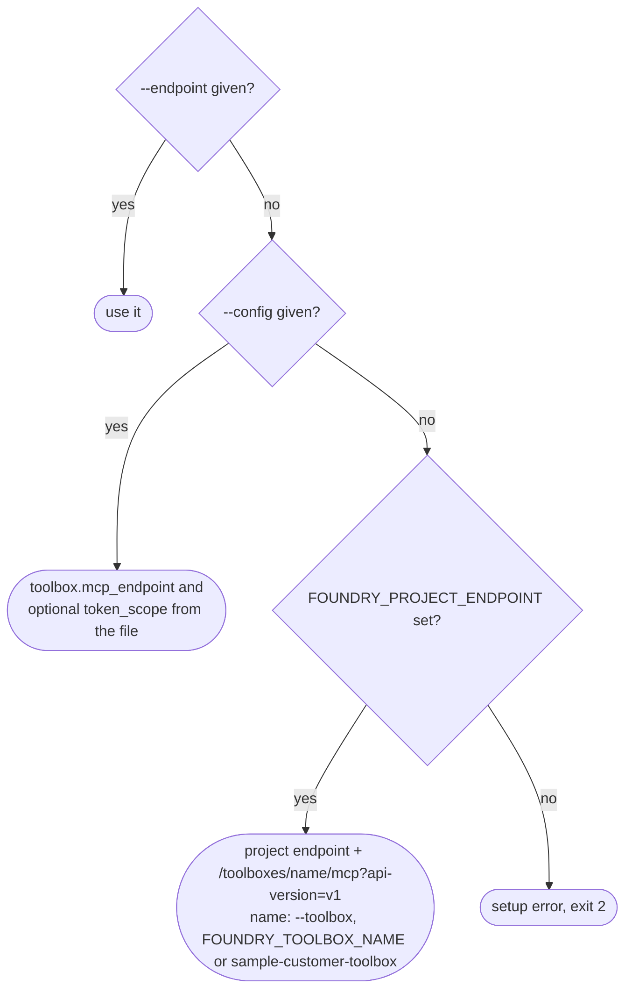

### Settings

Settings live in the git-ignored `.env`; the template is `.env.example`. Every entry point loads `.env` from the repo
root, and `run_assert.py` runs ASSERT from the repo root so it loads the same file.

| Variable | Used by | Purpose |
| --- | --- | --- |
| `FOUNDRY_PROJECT_ENDPOINT` | Target, deploy scripts, tool runner (default endpoint) | `https://<resource>.services.ai.azure.com/api/projects/<project>` |
| `FOUNDRY_TOOLBOX_NAME` | Tool runner, deploy scripts | Toolbox name, default `sample-customer-toolbox` |
| `FOUNDRY_AGENT_NAME` | Target, `deploy_agent.py`, `run_cloud_eval.py --target` | Agent name, default `customer-assistant` |
| `FOUNDRY_EVAL_JUDGE_DEPLOYMENT` | `run_cloud_eval.py` | Model deployment that Foundry's evaluators judge with, default `gpt-4-1-mini` |
| `AZURE_API_BASE`, `ASSERT_AZURE_USE_AAD` | assert-ai | Endpoint and Entra auth for ASSERT's models |
| `APPLICATIONINSIGHTS_CONNECTION_STRING` | `evals/telemetry.py` | Turns on span export |
| `APPLICATIONINSIGHTS_USE_AAD` | `evals/telemetry.py` | Entra auth for ingestion |
| `OTEL_SERVICE_NAME` | `evals/telemetry.py` | Overrides the cloud role name |
| `OTEL_RESOURCE_ATTRIBUTES` | OpenTelemetry SDK | `service.instance.id=<name>` sets the cloud role instance; live CI sets `github-actions-<run id>` |
| `ENTRA_TENANT_ID`, `ENTRA_API_APP_ID` | `setup_entra.py` (writes), `deploy_toolbox.py`; the Entra sample server as Container App settings | The Entra sample's tenant and API app |
| `ENTRA_OAUTH_CLIENT_APP_ID` | `setup_entra.py` (writes), `deploy_toolbox.py --auth-type OAuth2` | The OAuth client app for identity passthrough |

## 10. Telemetry

`telemetry.init` always installs an OpenTelemetry tracer provider, so spans exist in-process; ASSERT's collector reads the
target's spans from it. Spans are exported only when `APPLICATIONINSIGHTS_CONNECTION_STRING` is set.

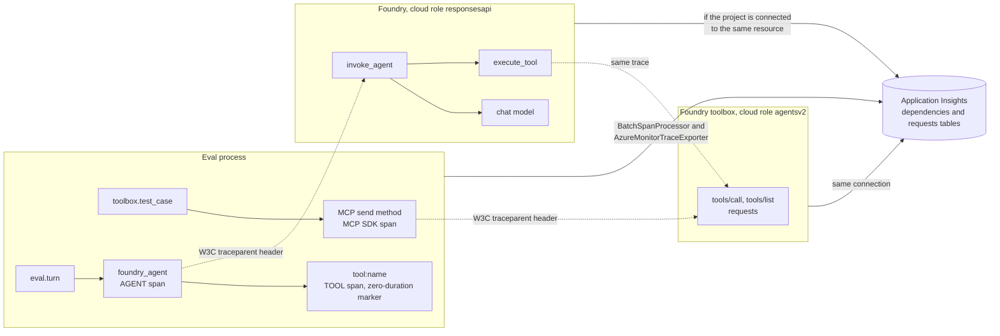

The first entry point to install the tracer provider sets the cloud role:

| Run | Cloud role | Spans |
| --- | --- | --- |
| Tool tests | `foundry-toolbox-tests` | `toolbox.test_case`, with the MCP SDK's `MCP send <method>` spans as children and the toolbox's requests under those |
| Deterministic agent evals | `foundry-agent-evals` | `eval.turn`, with the target's `foundry_agent` and `tool:*` spans as children |
| ASSERT, or the target run on its own | `foundry-agent-target` | `foundry_agent`, `tool:*` |

`OTEL_SERVICE_NAME` overrides all three. The cloud role instance is the host name unless `OTEL_RESOURCE_ATTRIBUTES` sets
`service.instance.id`, as live CI does. Because the target injects `traceparent`, Foundry's server spans share the eval
turn's `operation_Id`, so one trace runs from the eval turn through the model and tool calls, down to the toolbox's
`agentsv2` requests. Use the server-side spans for real tool latency: `execute_tool` for the agent's view, the toolbox's
`tools/call` requests for the tool's. The tool runner sends `traceparent` too, as an HTTP header, because the toolbox
ignores the MCP SDK's `params._meta` copy; so a tool-test case's trace also reaches the toolbox's requests
([telemetry.md](telemetry.md#3-what-is-emitted)). The `foundry_agent` span carries
`eval.platform_abort` and `eval.abort_reason`, and the agent version and tokens the response reports
(`gen_ai.agent.version`, `gen_ai.usage.input_tokens`, `gen_ai.usage.output_tokens`); consent links never reach a span.

## 11. Reliability

| Layer | Failure | Handling |
| --- | --- | --- |
| `evals/auth.py` | `az` token call fails | 3 attempts (2 s, 4 s); fails fast when not signed in or `az` is missing |
| Tool runner, HTTP | Connection fails | HTTP transport retries (3) |
| Tool runner, session | Session lost mid-run: the transport fails, or a request fails with `CONNECTION_CLOSED` and a ping does too (the MCP SDK closes a session for good when its stream ends) | The current case fails as `transport_error`; reconnects up to 3 times (2, 4, 8 s); after that, the remaining cases are reported as not run. A `CONNECTION_CLOSED` that a ping survives (only that request's stream ended) fails just that case |
| Tool runner, first connect | Any failure, including a tool source that needs consent | Setup error, exit 2; consent links are printed to the console |
| Agent target | HTTP 408, 429, 5xx, connection errors | Up to 8 attempts, honoring `Retry-After` (up to 60 s), else 5, 10, 20, 30 s backoff (about 2.5 minutes in total) |
| Agent target | Consent needed, or the agent's tools can't be listed | Not retried; the turn fails as not run, and ASSERT records a target error |
| Agent target | Read timeout (180 s) | Not retried; the turn fails |
| Agent-eval runner | Any exception in a turn | The turn fails with a runner error; the run continues |
| Cloud-eval runner, evals API | HTTP 408, 429, 5xx, connection errors, read timeouts (120 s) | A GET gets up to 6 attempts, waiting as the agent target does. A POST is resent only on 408, 429 or a request that never got through, so an evaluation or a run is never created twice |
| Cloud-eval runner, evaluation run | The run fails, is canceled or outlasts `--timeout` (30 minutes) | Setup error, exit 2; the run's error and id go to the console |
| Deploy scripts (`_az.rest`) | DNS, connection, 429, 502, 503, 504, and Graph replication delays | 6 attempts, waiting 10, 20, 30, 40, 50 s. A POST is retried only when it can't have been applied (DNS or connect failure, 429, replication delay), so a lost response can't create a second app, version or secret |
| ASSERT | Interrupted run | Completed stages are cached and reused |

Both runners exit 0 when every case passes, 1 when any fails, and 2 on a setup problem: invalid cases, a missing endpoint
or config, or no sign-in. Only the tool runner's first connection is part of setup, so there a connection failure or a
tool source that needs consent exits 2; the agent runner fails the affected turns and runs the rest.
`run_cloud_eval.py` exits 0 when every turn passed, 1 when one failed, errored or wasn't judged (with
`--fail-on unjudged`, only when one errored or wasn't judged), and 2 on a setup error, an error from the evals API, or an
evaluation run that failed, was canceled or didn't end in time.
`scripts/run_assert.py` exits 2 on usage errors and otherwise returns ASSERT's exit code.

## 12. Sample deployment

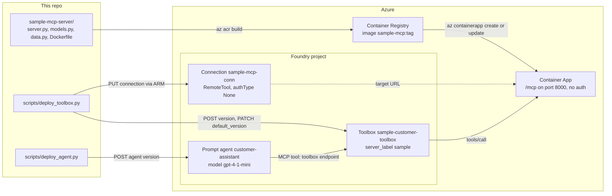

The server uses the `mcp` SDK's `MCPServer` and serves Streamable HTTP at `/mcp`. Its data is synthetic (`data.py`). A
`ToolError` reaches the caller as an `isError` result that keeps its message. Each tool publishes an `outputSchema`, made
from a Pydantic model in `models.py`, and returns its result twice: as `structuredContent` and as the same compact JSON
text. `MCPServer` checks the structured content against the model before it replies.

The Entra stack deploys beside this one from the same image, with `AUTH_MODE=entra`, an OAuth2 connection, its own
toolbox and agent; its diagram is in [entra.md](entra.md#3-what-the-sample-deploys). In that mode `entra_auth.py`
accepts only Entra user tokens issued to the server's API app, and the tools authorize from the token's app roles:
`get_customer`, and `get_stock_quote` by customer ID, return a normal `access_denied` result for customers outside the
caller's regions, and their `outputSchema` is an inline `anyOf` of the record and the denial. Denials are results rather
than tool errors, so the agent gets structured fields to explain them (and when the sample was built, a tool error
aborted the whole agent request).

| Tool, as named in the toolbox | Input | Returns | Error cases |
| --- | --- | --- | --- |
| `sample___get_customer` | `customer_id` (for example `C1001`) or `name` (full or partial, matching one customer) | Profile: industry, tier, region, account manager, contract value, ticker | Unknown customer or name, a name matching several customers (the error names none of them), no input or a blank one |
| `sample___get_market_conditions` | `industry`: manufacturing, healthcare, energy or retail | Outlook, YoY growth, sentiment, drivers, risks | Unsupported industry, missing argument |
| `sample___get_stock_quote` | `customer_id` or `ticker` | Price, change, market cap, P/E | Privately held customer (`C1005`), unknown ticker, no input |
| `sample___whoami`, only with `AUTH_MODE=entra` | none | The caller as the server sees them: name, username, `oid`, `tid`, roles, scopes, client app, token version, visible regions | none |

Deploy steps and current findings: [getting-started.md](getting-started.md) and [deploy/README.md](../deploy/README.md).

## 13. Platform behaviors the design handles

| Behavior | How the repo handles it |
| --- | --- |
| The toolbox names tools `<server_label>___<tool>` | Cases call `sample___get_customer` and so on |
| An unknown unprefixed tool returns JSON-RPC error -32602 "No tool config matches…" | `expect_error: "protocol"` |
| An unknown prefixed tool returns an `isError` result "Unknown tool: x" | `expect_error: "tool"` |
| In an agent run, the toolbox appends the tool's `structuredContent` to the `mcp_call` output as a `structuredResponse` block; direct calls return it as `structuredContent` | Stripped by the target (`_tool_output_text`), and by the tool runner (`split_output`) in case a direct call's text has it too |
| A tool error inside an agent run reaches the model only as text: the `mcp_call` item reports `status: completed` | Cases check the reply (`c-private`, `c-unknown-customer`), and the `tool_error_handling` ASSERT behavior judges it |
| Through October 2026, a tool error inside an agent run failed the whole Responses call (HTTP 400) | `platform_abort` fails the turn, and later turns report `history_gap` |
| Local DNS and connection failures lasting minutes have been observed | Retries in the target and in `_az.rest` |
| The toolbox reports a failing tool source (consent needed, or the server rejected the token) as a JSON-RPC error, and the agent as an `oauth_consent_request` item or HTTP 400 | `toolbox_errors.classify`: the outcomes `consent_required` and `upstream_error`, and the abort reasons `consent_required` and `tool_listing_failed` |
| A consent link binds whoever completes it to the user's connection | Printed to the console only; never in results, failure text, spans or ASSERT transcripts |
| `UserEntraToken` can't get a token for a custom MCP server's audience | The Entra sample uses OAuth2 identity passthrough |
| A denial returned as a tool error would reach the agent as text only, or abort the request as it did through October 2026 | The Entra sample returns denials as normal `access_denied` results |
| An MCP server starting from zero takes about 20 s, and the toolbox fails agent requests meanwhile (HTTP 400 `McpProtocolException`, protocol version `2026-07-28`) | The sample servers keep one replica (`--min-replicas 1`); the target reports such turns as `platform_abort` with `abort_reason` `tool_listing_failed` or `tool_call_failed` |
| A request that continues a stored response (`previous_response_id`) without naming the agent fails with HTTP 400 "Missing required parameter: 'model'" | The target sends `agent_reference` on every request |
| A conversation replayed as text carries no earlier tool results, and the agent may then state a figure no tool returned | Later turns continue the stored response by default (`history` `chain`); `c-recall` checks it |
| Foundry's `tool_call_accuracy` rates a tool call that returns an error 2 of 5 ("no successful retry"), even when the error is the right answer, such as an unknown or privately held customer | This repo's `tool_use`, which counts a right call that returns an error as right, replaced it as a default (`c-private`, `c-unknown-customer`) |
| `task_adherence` sees a chained conversation's earlier turns as text, without their tool results, so it fails a figure recalled from an earlier lookup as ungrounded | This repo's `grounded_adherence`, which gets the earlier turns with their tool results (`{{item.query_history_list}}`), replaced it as a default (`c-recall` turn 2) |
| Judged with `max_num_turns` 1, a chained later turn has no conversation or tool definitions, and `tool_call_accuracy` errors | `--max-turns` defaults to the run's longest conversation |
| Foundry stores an assistant input message with plain-string content as `input_text`, and its evaluators then reject the conversation ("Invalid content type 'input_text' for message with role 'assistant'") | The target sends earlier replies as `output_text` content |
| An evaluation run with an agent target sends one message per item and can't continue a conversation | `--target` judges first turns and lists the rest as left out |
| Mapping `{{sample.tool_calls}}` to `tool_call_accuracy` makes it skip the turn: the field holds messages | Target runs map only `query`, `response` (`{{sample.output_items}}`) and `tool_definitions` |
| Creating an evaluator version in the project's catalog is a preview feature: the request needs the header `Foundry-Features: Evaluations=V1Preview` | The runner sends it on every catalog request |
| The evaluator catalog doesn't return the tags a version was created with, but returns its definition as sent | The runner finds the version to reuse by its definition |

## 14. Design decisions

- **Tests vs. evals.**
  - Tool tests isolate the toolbox, so a failure points at the toolbox or the MCP server rather than at the model.
  - Agent evals measure what users get.
- **REST instead of the Foundry SDK.** `azure-ai-projects` requires `openai>=3`, which conflicts with assert-ai's
  `openai<3` pin, so the target and the cloud-eval runner call the Responses and evals APIs with `urllib`.
- **The official `mcp` client.**
  - The tool runner uses the same protocol stack as real MCP clients, with one session per run.
  - It has no HTTP read timeout; each request is bounded by an MCP request timeout instead.
- **Two agent scorers.** Deterministic checks give exact, cheap, repeatable regression signals. ASSERT covers behaviors
  that need judgment.
- **Foundry's evaluators beside the checks, not instead of them.** They judge in the service, with no judge to host and
  every run in the portal, but they rate general qualities, and a judge can fail correct turns, as the built-in
  `task_adherence` and `tool_call_accuracy` did ([§13](#13-platform-behaviors-the-design-handles)), so each verdict is
  reported beside the same reply's deterministic result. Judging stored responses is the default: the judge sees the
  very replies the checks scored, chained history included, and the agent isn't called again.
- **This repo's evaluators in place of two built-in ones.** The built-in evaluators' prompts can't be changed, and no
  setting stopped them failing correct tool errors and recalled figures, so two prompt evaluators judge tool use and
  grounding instead. Their prompts live in the repo, so a change is reviewed like code; the runner registers them in the
  project's catalog, a version per definition, so every evaluation names the prompt it ran.
- **Validate first.** Bad cases stop a run before any Azure call. Exit codes are the same across runners, so CI can tell
  setup problems from test failures.
- **Results are local JSON.** Reports and baseline diffs read those files; telemetry is optional and is not the record.
- **Chained multi-turn.** A later turn continues the stored response of the turn before (`previous_response_id`), so
  the agent keeps its earlier tool results, as it does in a chat. Replaying the text dropped them, and the agent then
  sometimes made up a figure it had fetched before. Continuing a response, unlike a Foundry conversation, needs nothing created
  or deleted, and a retried request continues the same response. `--history replay` keeps the old behavior.
- **No environment values in git.**
  - Tenant, subscription and resource identifiers live only in `.env`, `config/*.local.json` and
    `deploy/resources.local.md`, all git-ignored.
  - Case data is synthetic.
- **Per-user identity as the signed-in user.**
  - The runners act as the `az login` user, so a test sees what that user's agent would.
  - Cases name no real user: `{{caller.*}}` placeholders fill in the identity at run time.
  - OAuth2 identity passthrough is the supported path, because `UserEntraToken` doesn't work for custom servers.
- **Consent links stay on the console.** Whoever completes a link binds their account to the connection, so the runners
  treat links like secrets.
- **Live CI signs in as a managed identity.**
  - GitHub's OIDC token is exchanged for an Entra token, so no Azure secret is stored, and the federated credential
    trusts only the `live` environment, which only `main` can use.
  - `az` does the sign-in, so the runners' `AzureCliCredential` works unchanged.
  - Result files stay on the runner because they name the endpoint. The reports don't, so they go to the job summary.
  - Foundry's evaluators judge the agent evals' stored replies, but only turns they couldn't judge fail the job
    (`--fail-on unjudged`). An LLM judge can fail correct turns, as the built-in evaluators did on the sample suite, so
    failing on its verdicts would make the job flaky; its verdicts are in the report.

## 15. Extending

| Goal | Where |
| --- | --- |
| Test another toolbox or agent | `.env`, or `--endpoint`, `--config`, `--toolbox`; see [existing-environment.md](existing-environment.md) |
| Add tool tests | A JSONL file under `data/tool-tests/`; check it with `scripts/validate_eval_jsonl.py` |
| Add agent scenarios | A JSONL file under `data/agent-evals/` |
| Add an ASSERT behavior | A new config in `evals/configs/` (one behavior per config), run with `scripts/run_assert.py` |
| Judge with other Foundry evaluators | `run_cloud_eval.py --evaluators` with built-in names (without `builtin.`); each set gets its own evaluation, and the report describes evaluators outside `CLOUD_REASONS` in general terms |
| Add or change one of this repo's evaluators | A judge prompt `evals/evaluators/<name>.md` that uses `{{query}}`, `{{response}}` and `{{tool_definitions}}` and answers with a reason, then a score from 1 to 5; the name and its catalog description in `CUSTOM_EVALUATORS` in `evals/run_cloud_eval.py`, and its meaning in `CLOUD_REASONS`. The next run registers the new version. Check a changed prompt over several runs: the judge varies |
| Add an assertion type | `$defs.assertion` in `schemas/tool-test.schema.json`, `ASSERTION_FIELDS` in `evals/cases.py`, `check()` in `tooltests/run.py`, plus unit tests |
| Add a failure reason | `Failure("code", message)` in the runner, and the code's meaning in `TOOL_REASONS`, `AGENT_REASONS` or `CLOUD_REASONS` in `evals/reasons.py`; `tests/test_reasons.py` fails on undescribed codes |
| Add a span attribute | `telemetry.span(...)` calls in the runners; document it in [telemetry.md](telemetry.md) |
| Test a toolbox that passes the user's identity | [entra.md](entra.md): consent once, then allowed and denied cases that use `{{caller.*}}` placeholders |
| Run suites daily in GitHub Actions | `.github/workflows/live.yml` and the `live` environment; see [live-ci.md](live-ci.md) |
| Add a caller placeholder | `CALLER_FIELDS` in `evals/cases.py` and `auth.caller_claims`, plus unit tests |
