# Architecture

This document covers how the repo evaluates a Microsoft Foundry toolbox: its components, how a run flows through them, the
data they exchange, and the reasons behind the design.

For setup, see [getting-started.md](getting-started.md) (the sample deployment) or
[existing-environment.md](existing-environment.md) (your own project). Spans and queries are in [telemetry.md](telemetry.md).

## 1. Evaluation paths

The repo tests a toolbox at two levels. *Tests* call the toolbox directly; *evals* go through an agent connected to it.

| Path | Entry point | Calls | Checks | Output |
| --- | --- | --- | --- | --- |
| Tool tests | `python -m tooltests.run` | Toolbox MCP endpoint (Streamable HTTP, JSON-RPC) | Tool listing and definitions, results (assertions), error outcomes, auth status codes, latency | `results/tool-tests/run-*.json` |
| Agent evals, deterministic | `python -m evals.run_agent_evals` | Prompt agent through the Responses API | Expected tool calls and arguments (optionally ordered), forbidden calls, response regexes, latency | `results/agent-evals/run-*.json` |
| Agent evals, ASSERT | `python scripts/run_assert.py <config>` | `assert-ai`, which drives the agent through `evals/foundry_agent/target.py` and judges it with an LLM | Violation rate for one behavior per config (for example ungrounded figures, raw error replies) | `results/assert/results/<suite>/<run>/` |

The two agent-eval paths complement each other:

- The deterministic runner checks exact calls and parameters, which ASSERT does not.
- ASSERT judges open-ended behavior, which regexes cannot.
- Both call the agent through the same target code, so a platform quirk shows up the same way in each.

## 2. System context

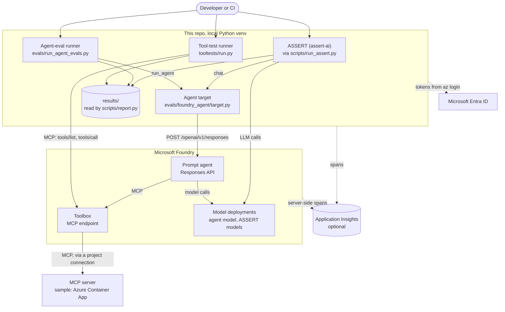

Everything runs locally against live Azure resources; no eval code runs inside Azure. Resource identifiers come from the
git-ignored `.env`, and tracked files contain none.

## 3. Components

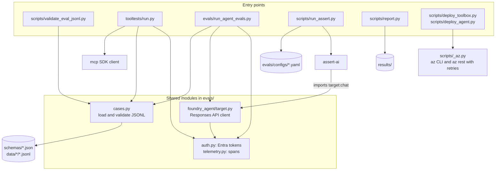

| Module | Responsibility |
| --- | --- |
| `tooltests/run.py` | MCP client for the toolbox: one session per run, outcome classification, assertions, latency percentiles, reconnects |
| `evals/run_agent_evals.py` | Replays multi-turn conversations against the agent and scores every turn |
| `evals/foundry_agent/target.py` | Calls the agent through the Responses API with retries, reads `mcp_call` and `message` output items, detects platform aborts and emits agent and tool spans. Its `chat()` is ASSERT's callable target |
| `evals/cases.py` | Finds, parses and validates JSONL cases (JSON Schema plus cross-field and cross-file rules) |
| `evals/auth.py` | Entra tokens from `az login`, cached per scope and refreshed 5 minutes before expiry |
| `evals/telemetry.py` | `span()` helper and the optional App Insights exporter; does nothing without a connection string |
| `scripts/run_assert.py` | Runs `assert-ai run` from the repo root with artifacts under `results/assert` |
| `scripts/report.py` | Markdown reports and baseline diffs for all three result types |
| `scripts/validate_eval_jsonl.py` | Validates case files without running them |
| `scripts/deploy_toolbox.py`, `deploy_agent.py`, `_az.py` | Create the connection, toolbox version and agent version through `az rest` |
| `sample-mcp-server/` | Synthetic three-tool MCP server, packaged as a container image |
| `tests/` | Offline unit tests: no Azure access or `.env` needed |

## 4. Cases and results

### Case formats

Cases are JSONL, one object per line, validated against `schemas/tool-test.schema.json` and
`schemas/agent-eval.schema.json`.

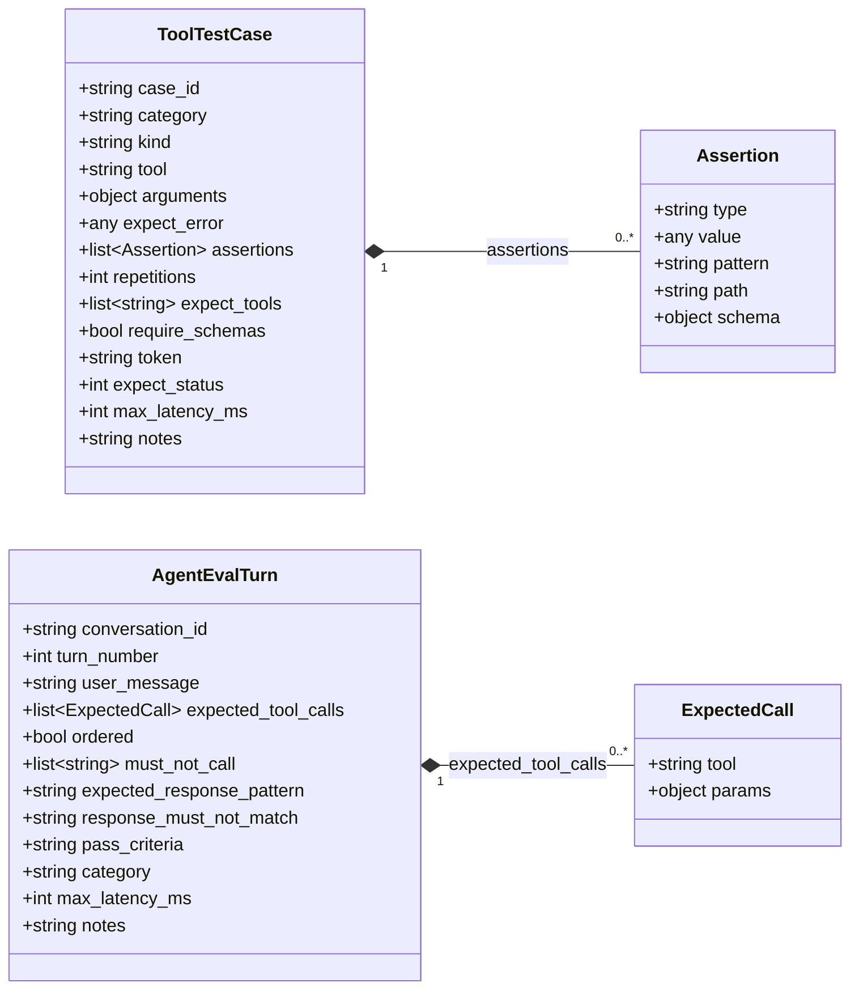

Each tool-test `kind` uses its own fields. The validator flags fields the kind ignores.

| `kind` | Required | Optional |
| --- | --- | --- |
| `call` (default) | `tool`, `arguments` | `expect_error` (`false`, `true` or `"tool"`, `"protocol"`), `assertions`, `repetitions`, `max_latency_ms` |
| `list` | `expect_tools` | `require_schemas`, `max_latency_ms` |
| `auth` | `token` (`invalid` or `none`), `expect_status` | none |

Assertion types:

- `contains` (`value`, case-insensitive)
- `regex` (`pattern`)
- `json_path_equals` (`path`, `value`)
- `json_path_exists` (`path`)
- `schema` (`schema`)

For agent turns, `expected_tool_calls` is required but may be empty, for example when only the reply matters.

### Validation

Both runners validate every case before running any, and `scripts/validate_eval_jsonl.py` performs the same checks
without running them.

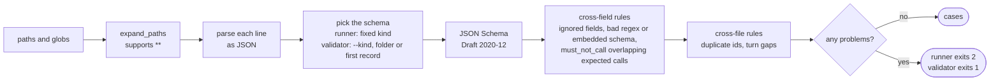

### Result files

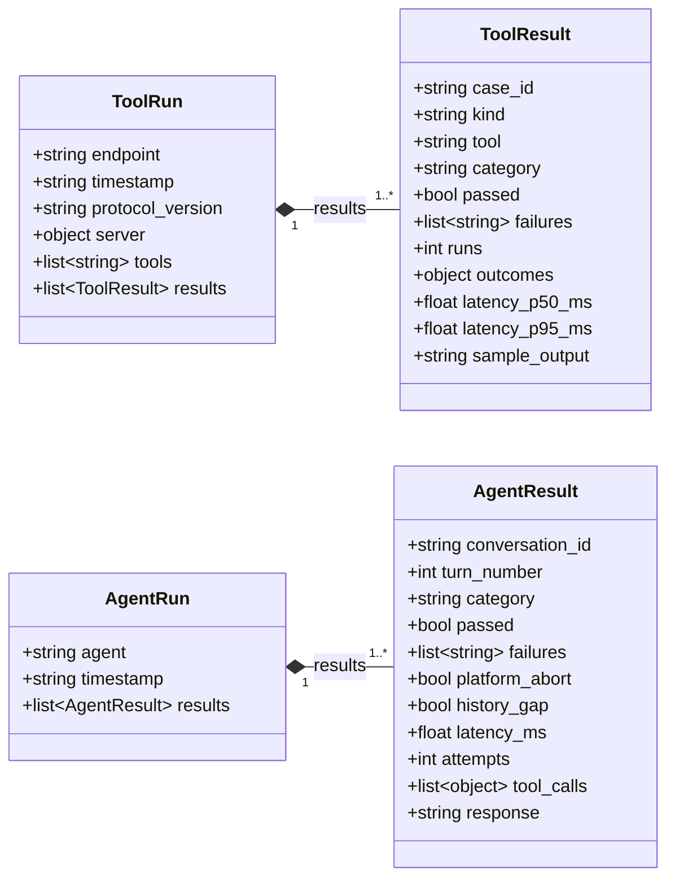

- `outcomes` counts outcomes across repetitions.
- `latency_ms` and `attempts` are null when a turn raised.
- `report.py` matches results to a baseline by `case_id`, or by conversation and turn.

## 5. Tool tests

### Run sequence

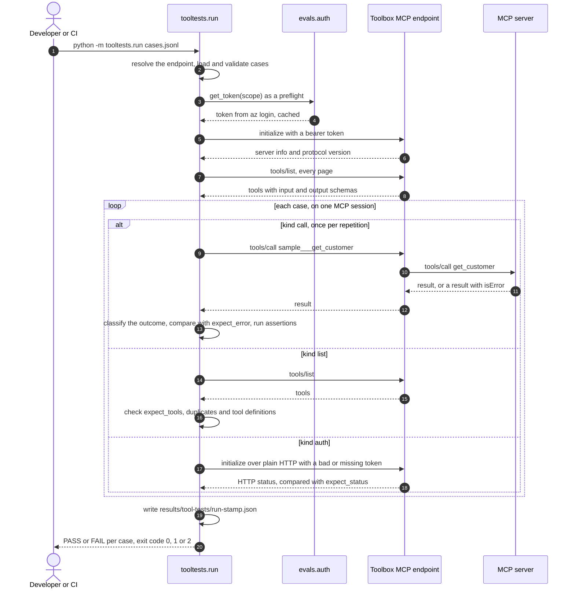

- Before each timed request the runner calls `auth.get_token`, which serves the cached token, so a token refresh never
  counts toward a call's latency.
- `auth` cases use a separate HTTP client, because the MCP session cannot send a bad token.

### Outcomes

Every request ends in exactly one outcome:

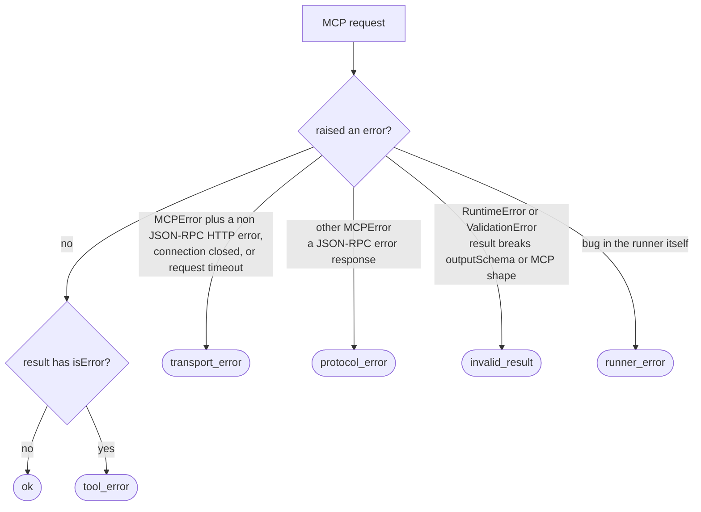

A run passes when both of these hold:

1. Its outcome is the expected one. `expect_error` maps to the expected outcome:
   - `false` → `ok`
   - `true` or `"tool"` → `tool_error`
   - `"protocol"` → `protocol_error`
2. Every assertion holds.

Assertions run only on the expected outcome, so they can check error text as well.

- `invalid_result`, `transport_error` and `runner_error` always fail.
- A case passes when every repetition passes and none exceeds `max_latency_ms`.
- The results record p50 and p95 latency across repetitions.

### Session lifecycle

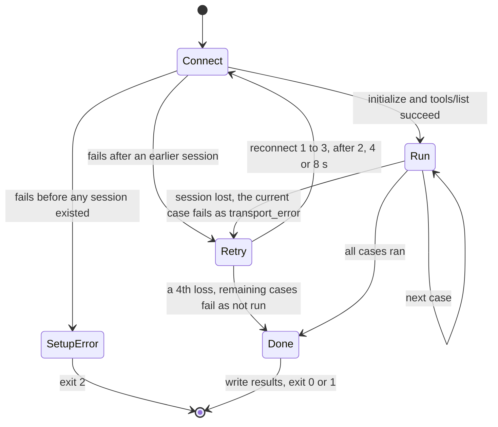

The HTTP client has no read timeout. A read timeout inside an MCP POST tears down the whole session, so the MCP-level
request timeout (`--timeout`, default 60 s) bounds each request instead and reports `transport_error`. Connection
attempts are retried by the HTTP transport (3 retries).

## 6. Agent evals

### One agent turn

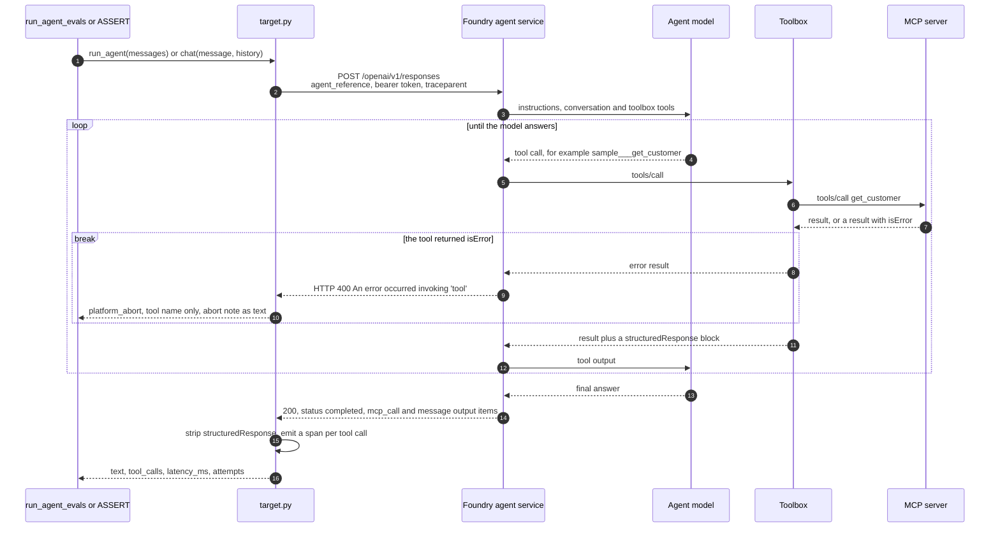

The agent service does not hand tool errors back to the model. An `isError` result fails the whole Responses call, so the
agent never gets a chance to recover. The target reports this as `platform_abort`, with the tool name parsed from the error and no
arguments. The `tool_error_handling` ASSERT config catches the raw failure text that users would see.

### Retries

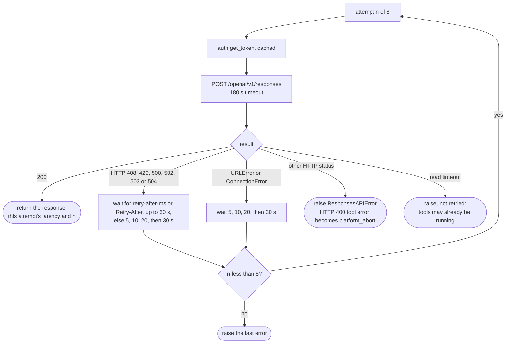

`latency_ms` covers the final attempt only, so token fetches and retry waits are excluded. `attempts` records how many
tries the turn needed.

### Scoring a turn

| Check | Applies when | Rule |
| --- | --- | --- |
| `expected_tool_calls` | `pass_criteria` is `tool_called_correctly` or `both` | See the matching rules below |
| `must_not_call` | always | None of these tools was called |
| `expected_response_pattern` | `pass_criteria` is `response_matches` or `both` | Case-insensitive regex search over the whole reply |
| `response_must_not_match` | always | The reply does not match |
| `max_latency_ms` | always, if set | Latency of the final HTTP attempt |

How `expected_tool_calls` are matched:

- Each expected call must match a call the agent made, with the same name and every listed param equal. Strings compare
  case-insensitively, and a `re:` prefix makes a param a regex search.
- Extra params and extra calls are allowed.
- With `ordered`, the matches must occur in order.
- A platform-aborted call matches on name only, because its arguments are unknown.

### Multi-turn conversations

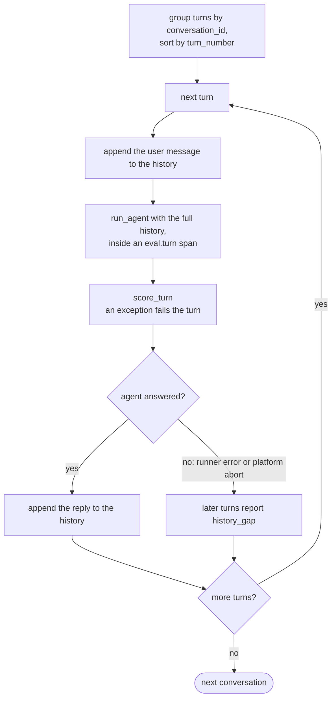

Each request replays the conversation as text: every user message, plus the assistant replies received so far. Tool
results from earlier turns are not replayed, so the agent calls tools again when it needs the data. Using
`previous_response_id` or Foundry conversations would keep that state; this is listed under Next in [plan.md](plan.md).

## 7. ASSERT

[ASSERT](https://commandline.microsoft.com/assert-written-intent-executable-evals/) (`assert-ai`) turns a written behavior
into generated test cases, runs them against the agent, and has an LLM judge each transcript. Each config in
`evals/configs/` covers one behavior.

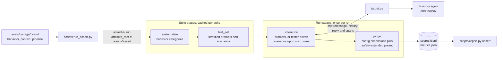

ASSERT's own model calls go through LiteLLM to `azure/<deployment>`:

- They include category generation, test generation, the tester that plays the user, and the judge.
- They use `AZURE_API_BASE`, with Entra auth when `ASSERT_AZURE_USE_AAD=1`.
- The judge needs a large `max_tokens` (24000) for a reasoning model.

Completed stages are cached, so a new run reuses the suite's categories and test set.

```text
results/assert/results/<suite>/
  taxonomy.json, test_set.jsonl, ...   suite stages, reused by later runs
  <run>/                               for example baseline
    inference_set.jsonl                transcripts with per-turn trace data
    scores.jsonl, metrics.json         judge verdicts and metrics
    manifest.json, config.yaml         stage status and the resolved config
```

### How the judge sees tool calls

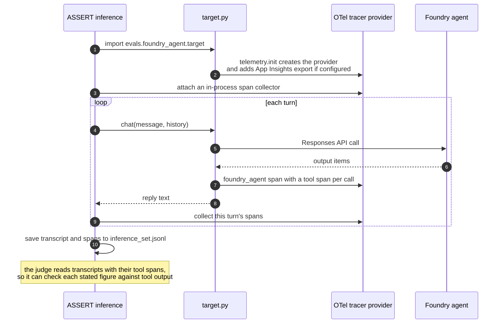

## 8. Authentication and configuration

### Tokens

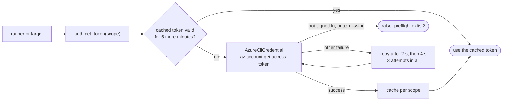

| Caller | Credential | Audience |
| --- | --- | --- |
| Tool runner, agent target | `evals.auth` (AzureCliCredential, cached, thread-safe) | `https://ai.azure.com/.default`; the tool runner can take `token_scope` from `--config` |
| ASSERT model calls | assert-ai's Entra auth (`ASSERT_AZURE_USE_AAD=1`) | Azure OpenAI at `AZURE_API_BASE` |
| App Insights export | AzureCliCredential if `APPLICATIONINSIGHTS_USE_AAD=1`, else the connection string's key | App Insights ingestion |
| Deploy scripts | `az rest` | Azure Resource Manager (connection), `https://ai.azure.com` (toolbox, agent) |
| Toolbox to the sample MCP server | The connection's `authType: None` | Unauthenticated sample server |

### Toolbox endpoint

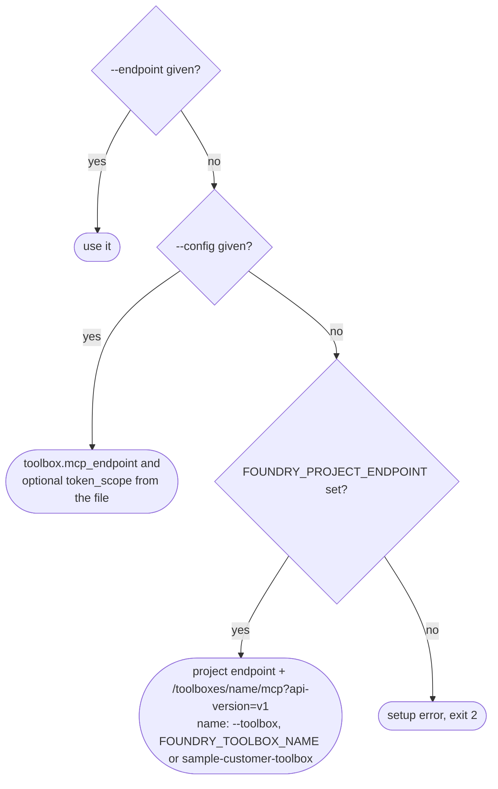

### Settings

Settings live in the git-ignored `.env`; the template is `.env.example`. Every entry point loads `.env` from the repo
root, and `run_assert.py` runs ASSERT from the repo root so it loads the same file.

| Variable | Used by | Purpose |
| --- | --- | --- |
| `FOUNDRY_PROJECT_ENDPOINT` | Target, deploy scripts, tool runner (default endpoint) | `https://<resource>.services.ai.azure.com/api/projects/<project>` |
| `FOUNDRY_TOOLBOX_NAME` | Tool runner, deploy scripts | Toolbox name, default `sample-customer-toolbox` |
| `FOUNDRY_AGENT_NAME` | Target, `deploy_agent.py` | Agent name, default `customer-assistant` |
| `AZURE_API_BASE`, `ASSERT_AZURE_USE_AAD` | assert-ai | Endpoint and Entra auth for ASSERT's models |
| `APPLICATIONINSIGHTS_CONNECTION_STRING` | `evals/telemetry.py` | Turns on span export |
| `APPLICATIONINSIGHTS_USE_AAD` | `evals/telemetry.py` | Entra auth for ingestion |
| `OTEL_SERVICE_NAME` | `evals/telemetry.py` | Overrides the cloud role name |

## 9. Telemetry

`telemetry.init` always installs an OpenTelemetry tracer provider, so spans exist in-process; ASSERT's collector reads the
target's spans from it. Spans are exported only when `APPLICATIONINSIGHTS_CONNECTION_STRING` is set.

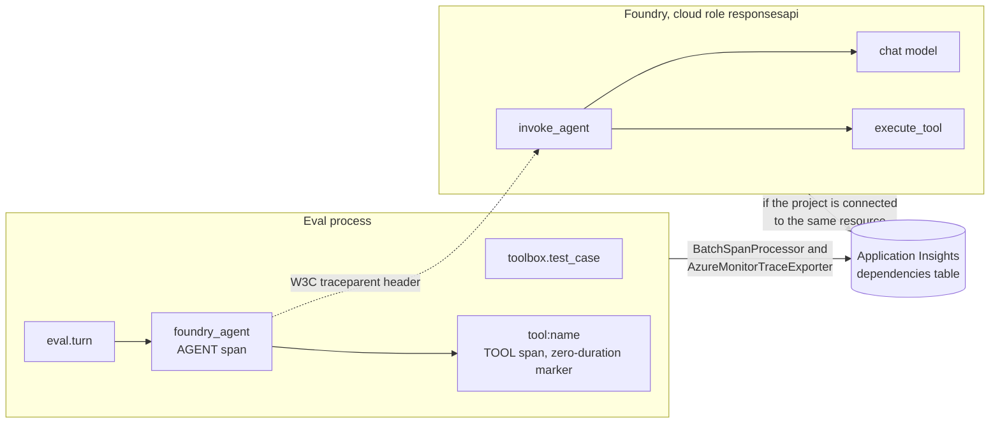

The first entry point to install the tracer provider sets the cloud role:

| Run | Cloud role | Spans |
| --- | --- | --- |
| Tool tests | `foundry-toolbox-tests` | `toolbox.test_case` |
| Deterministic agent evals | `foundry-agent-evals` | `eval.turn`, with the target's `foundry_agent` and `tool:*` spans as children |
| ASSERT, or the target run on its own | `foundry-agent-target` | `foundry_agent`, `tool:*` |

`OTEL_SERVICE_NAME` overrides all three. Because the target injects `traceparent`, Foundry's server spans share the eval
turn's `operation_Id`, so one trace runs from the eval turn through the model and tool calls. Use the server-side
`execute_tool` spans for real tool latency.

## 10. Reliability

| Layer | Failure | Handling |
| --- | --- | --- |
| `evals/auth.py` | `az` token call fails | 3 attempts (2 s, 4 s); fails fast when not signed in or `az` is missing |
| Tool runner, HTTP | Connection fails | HTTP transport retries (3) |
| Tool runner, session | Session lost mid-run | The current case fails as `transport_error`; reconnects up to 3 times (2, 4, 8 s); after that, the remaining cases are reported as not run |
| Tool runner, first connect | Any failure | Setup error, exit 2 |
| Agent target | HTTP 408, 429, 5xx, connection errors | Up to 8 attempts, honoring `Retry-After` (up to 60 s), else 5, 10, 20, 30 s backoff (about 2.5 minutes in total) |
| Agent target | Read timeout (180 s) | Not retried; the turn fails |
| Agent-eval runner | Any exception in a turn | The turn fails with a runner error; the run continues |
| Deploy scripts (`_az.rest`) | DNS, connection, 429, 502, 503, 504 | 6 attempts, waiting 10, 20, 30, 40, 50 s |
| ASSERT | Interrupted run | Completed stages are cached and reused |

All runners exit 0 when every case passes, 1 when any fails, and 2 on a setup problem (invalid cases, config, sign-in,
connection).

## 11. Sample deployment

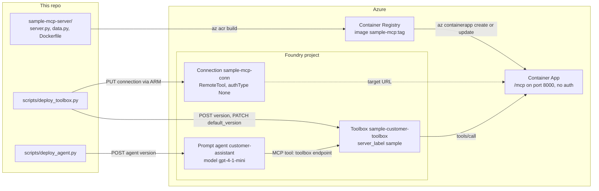

The server uses the `mcp` SDK's `MCPServer` and serves Streamable HTTP at `/mcp`. Its data is synthetic (`data.py`). A
`ToolError` reaches the caller as an `isError` result that keeps its message.

| Tool, as named in the toolbox | Input | Returns | Error cases |
| --- | --- | --- | --- |
| `sample___get_customer` | `customer_id` (for example `C1001`) or `name` | Profile: industry, tier, region, account manager, contract value, ticker | Unknown customer or name, no input |
| `sample___get_market_conditions` | `industry`: manufacturing, healthcare, energy or retail | Outlook, YoY growth, sentiment, drivers, risks | Unsupported industry, missing argument |
| `sample___get_stock_quote` | `customer_id` or `ticker` | Price, change, market cap, P/E | Privately held customer (`C1005`), unknown ticker, no input |

Deploy steps and current findings: [getting-started.md](getting-started.md) and [deploy/README.md](../deploy/README.md).

## 12. Platform behaviors the design handles

| Behavior | How the repo handles it |
| --- | --- |
| The toolbox names tools `<server_label>___<tool>` | Cases call `sample___get_customer` and so on |
| An unknown unprefixed tool returns JSON-RPC error -32602 "No tool config matches…" | `expect_error: "protocol"` |
| An unknown prefixed tool returns an `isError` result "Unknown tool: x" | `expect_error: "tool"` |
| The toolbox appends a `structuredResponse` block to tool text | Stripped by the tool runner (`split_output`) and the target (`_tool_output_text`) |
| A tool error inside an agent run fails the whole Responses call (HTTP 400) | `platform_abort`, `history_gap`, and the `tool_error_handling` ASSERT behavior |
| Local DNS and connection failures lasting minutes have been observed | Retries in the target and in `_az.rest` |

## 13. Design decisions

- **Tests vs. evals.**
  - Tool tests isolate the toolbox, so a failure points at the toolbox or the MCP server rather than at the model.
  - Agent evals measure what users get.
- **REST instead of the Foundry SDK.** `azure-ai-projects` requires `openai>=3`, which conflicts with assert-ai's
  `openai<3` pin, so the target calls the Responses API with `urllib`.
- **The official `mcp` client.**
  - The tool runner uses the same protocol stack as real MCP clients, with one session per run.
  - It has no HTTP read timeout; each request is bounded by an MCP request timeout instead.
- **Two agent scorers.** Deterministic checks give exact, cheap, repeatable regression signals. ASSERT covers behaviors
  that need judgment.
- **Validate first.** Bad cases stop a run before any Azure call. Exit codes are the same across runners, so CI can tell
  setup problems from test failures.
- **Results are local JSON.** Reports and baseline diffs read those files; telemetry is optional and is not the record.
- **Text replay for multi-turn.** Every request carries the conversation so far, which keeps runs stateless and makes any
  turn safe to retry. The cost is that earlier tool results are not replayed.
- **No environment values in git.**
  - Tenant, subscription and resource identifiers live only in `.env`, `config/*.local.json` and
    `deploy/resources.local.md`, all git-ignored.
  - Case data is synthetic.

## 14. Extending

| Goal | Where |
| --- | --- |
| Test another toolbox or agent | `.env`, or `--endpoint`, `--config`, `--toolbox`; see [existing-environment.md](existing-environment.md) |
| Add tool tests | A JSONL file under `data/tool-tests/`; check it with `scripts/validate_eval_jsonl.py` |
| Add agent scenarios | A JSONL file under `data/agent-evals/` |
| Add an ASSERT behavior | A new config in `evals/configs/` (one behavior per config), run with `scripts/run_assert.py` |
| Add an assertion type | `$defs.assertion` in `schemas/tool-test.schema.json`, `ASSERTION_FIELDS` in `evals/cases.py`, `check()` in `tooltests/run.py`, plus unit tests |
| Add a span attribute | `telemetry.span(...)` calls in the runners; document it in [telemetry.md](telemetry.md) |
