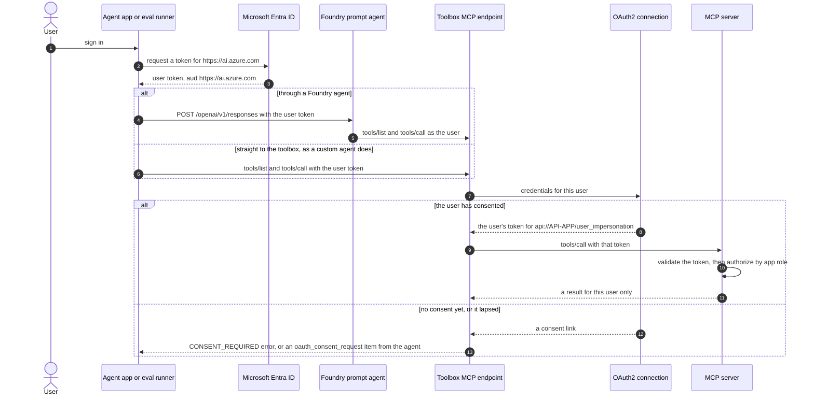
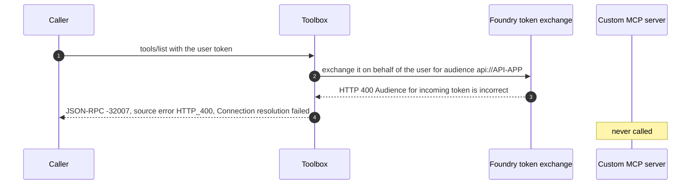
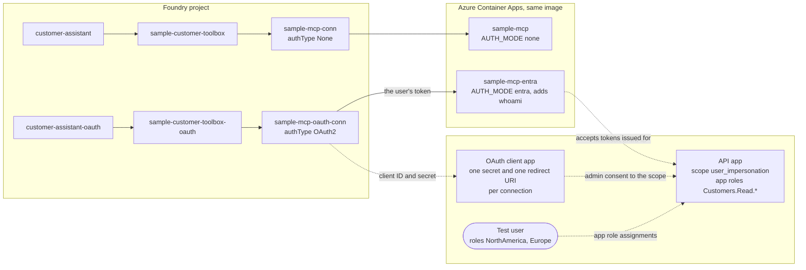
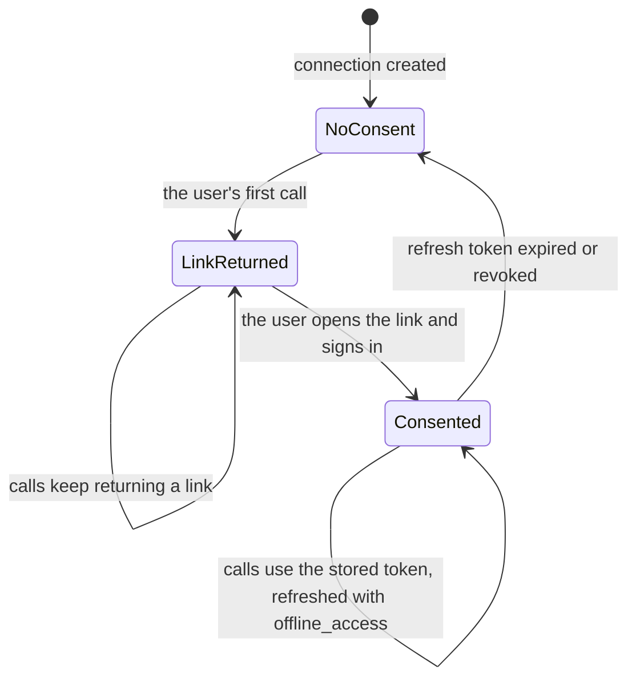
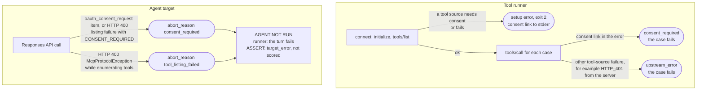

# Per-user Entra identity: agents, toolboxes and MCP servers

In production, an agent app signs the user in and calls Foundry with the user's token. With an OAuth2 project connection,
the toolbox then calls the MCP server *as that user*, so the server can decide what each user may see. This guide covers
how the identity flows, what to configure, how this repo deploys and tests it, and the limits found along the way.

The harness signs in as your `az login` user and plays both kinds of agent:

- **A custom agent** that calls the toolbox MCP endpoint itself with the user's token: the tool-test runner.
- **A Foundry prompt agent** invoked through the Responses API with the user's token: the agent-eval runners and ASSERT.

## 1. How the user's identity reaches the MCP server



There are two identities in every tool call:

- **Caller to toolbox.** The toolbox endpoint accepts only tokens for `https://ai.azure.com`. The MCP server never sees
  this token.
- **Toolbox to MCP server.** The connection holds a separate token per user, issued for the MCP server's own API. It gets
  that token through the OAuth2 authorization-code flow when the user consents, and refreshes it with `offline_access`.

The MCP server validates its token like any Entra-protected API and authorizes from the claims. The sample uses app
roles to filter customers by region.

## 2. Choose the connection auth type

| `authType` (REST; `azd` name) | Who the MCP server sees | Custom MCP server |
| --- | --- | --- |
| `None` (`none`) | Nobody: no credentials | Works. The original sample stack |
| `OAuth2` (`oauth2`), *identity passthrough* | The user who consented | **Works.** Verified end to end by this repo |
| `UserEntraToken` (`user-entra-token`) | The signed-in user, through an on-behalf-of exchange for the connection's audience | **Fails** (observed below) |

This matches Microsoft's guidance in [Toolbox authentication](https://learn.microsoft.com/en-us/azure/foundry/agents/how-to/tools/tool-authentication):
`oauth2` is for private and partner MCP servers, and `user-entra-token` is for managed Microsoft services that need an
audience-specific Entra token.

### What happened with UserEntraToken



- The exchange failed for both `api://<api-app-id>` and the bare app ID.
- Pre-authorizing the Azure Machine Learning first-party app, whose token service performs the exchange, on the API app
  made no difference.
- The same exchange succeeded for the first-party audience `https://mcp.ai.azure.com`, so the failure is specific to
  custom audiences.
- In the harness:
  - The tool runner stops at connect (exit 2).
  - A later `tools/call` fails with -32602 "Connection resolution failed", recorded as `upstream_error`.
  - Agent calls fail with HTTP 400 `McpProtocolException`, recorded as `tool_listing_failed`.
- To recheck later, deploy a separate connection and toolbox with
  `deploy_toolbox.py --auth-type UserEntraToken --connection <name> --toolbox <name>`. The audience defaults to
  `api://$ENTRA_API_APP_ID`; `--audience` overrides it.

## 3. What the sample deploys

The Entra stack runs beside the original one, so both can be tested from the same project:



With `AUTH_MODE=entra` the server (`sample-mcp-server/entra_auth.py`):

- Accepts only Entra access tokens issued to its API app for a user. It checks the signature (JWKS), `aud`, `iss`, `tid`,
  `exp` and the `user_impersonation` scope.
- Rejects requests with no token or a bad token with 401, plus a `WWW-Authenticate` header that points to its OAuth
  protected-resource metadata (`/.well-known/oauth-protected-resource/mcp`).
- Answers app-only tokens with 403 `insufficient_scope`.
- Logs non-identifying details (`aud`, `iss`, client, `scp`) of every rejected token.
- Reads `ENTRA_TENANT_ID` and `ENTRA_API_APP_ID`, plus two optional settings: `ENTRA_REQUIRED_SCOPE` (default
  `user_impersonation`) and `MCP_RESOURCE_URL` (default: the Container App's own `/mcp` URL).
- Adds a `whoami` tool, and filters customers by the caller's region roles:

| App role | Customers visible |
| --- | --- |
| `Customers.Read.NorthAmerica` | C1001, C1003 |
| `Customers.Read.Europe` | C1002, C1005 |
| `Customers.Read.APAC` | C1004 |
| `Customers.Read.All` | All |

A denied lookup returns a normal result, `{"access_denied": true, "customer_id", "region", "reason", "required_roles"}`,
with none of the customer's data. It is not a tool error, because a tool error aborts the whole agent request (see
[architecture.md](architecture.md#12-platform-behaviors-the-design-handles)). A quote by ticker is public, so it is not
filtered; a quote by customer ID is filtered, because it reveals the customer.

## 4. Set it up

You need:

- The original sample deployed ([getting-started.md](getting-started.md), steps 1-5). The Entra stack reuses its registry
  and Container Apps environment.
- A directory role that can register apps and grant tenant-wide admin consent, such as Cloud Application Administrator.
- The same tenant for users and the Foundry project. Learn notes that cross-tenant token exchange isn't supported.
- A project role for each test user that can invoke agents. Learn's minimum for consumers of an OAuth passthrough agent is
  **Foundry Agent Consumer**; the runners themselves need **Azure AI User**.

```powershell
# 1. Entra apps: the API app (scope, app roles, your role assignments) and the OAuth client app.
#    Saves ENTRA_TENANT_ID, ENTRA_API_APP_ID and ENTRA_OAUTH_CLIENT_APP_ID to .env.
.\.venv\Scripts\python scripts\setup_entra.py --oauth-client --write-env

# 2. The Entra-protected server: the same image, with AUTH_MODE=entra
az acr build -r <acr-name> -t sample-mcp:<tag> sample-mcp-server
az containerapp create -n sample-mcp-entra -g rg-toolbox-eval-sample --environment sample-env `
  --image <acr-name>.azurecr.io/sample-mcp:<tag> --registry-server <acr-name>.azurecr.io `
  --target-port 8000 --ingress external --min-replicas 1 `
  --env-vars AUTH_MODE=entra ENTRA_TENANT_ID=<tenant-id> ENTRA_API_APP_ID=<api-app-id>

# 3. The OAuth2 connection and its own toolbox
.\.venv\Scripts\python scripts\deploy_toolbox.py --mcp-url https://<entra-app-fqdn>/mcp --resource-group <foundry-rg> `
  --auth-type OAuth2 --connection sample-mcp-oauth-conn --toolbox sample-customer-toolbox-oauth

# 4. An agent on that toolbox
.\.venv\Scripts\python scripts\deploy_agent.py --agent customer-assistant-oauth --toolbox sample-customer-toolbox-oauth `
  --model <chat-deployment>

# 5. First run: prints the consent link and exits 2. Consent, then rerun.
.\.venv\Scripts\python -m tooltests.run data\tool-tests\sample-toolbox-entra.jsonl --toolbox sample-customer-toolbox-oauth
```

What the scripts do:

- **`setup_entra.py`** is idempotent.
  - API app: identifier URI `api://<appId>`, the `user_impersonation` scope, v2 access tokens and the four app roles.
  - Your role assignments: `--roles` sets exactly which roles you hold. The default is `NorthAmerica Europe`, so APAC is
    denied.
  - Trusted clients: tenant-wide consent for `--trusted-client` apps (default: the Azure CLI) to request the scope, so you
    can call the server directly.
  - `--oauth-client` adds the confidential client app, with admin consent to the API scope, `openid` and `offline_access`.
- **`deploy_toolbox.py --auth-type OAuth2`** writes these to the connection:
  - The Entra v2 authorize and token URLs; the refresh URL is the token URL.
  - The scopes `api://<api-app-id>/user_impersonation offline_access`.
  - The client ID and a new client secret.

  It then registers the connection's redirect URI on the client app. Each OAuth2 connection gets its own,
  `https://global.consent.azure-apim.net/redirect/<connector>`.
- **Secrets.**
  - The secret goes only to the connection. It is never printed or saved.
  - Each rerun rotates it (default lifetime 180 days, `--secret-days`) and removes the older secrets made for the same
    connection. Rerun before the secret expires.
  - Users kept their consent across a rerun that rotated the secret, and calls more than two hours later still worked:
    the connection refreshes their tokens with the new secret.
  - `--client-secret-env <VAR>` uses a secret you manage instead.

## 5. Consent

Consent is per user, per connection. The first call by a user who hasn't consented returns a consent link instead of a
result:



Rerunning `deploy_toolbox.py` rotates the client secret and keeps every user's consent.

What the runners do:

- They print the link to **stderr only**, once per tool source per run. Open it in a browser signed in as the test user; an
  InPrivate window avoids picking up another signed-in account. Approve, then rerun.
- **Don't share the link.** Whoever completes the sign-in binds their account to your connection. For that reason the
  link never appears in results, failure text, telemetry or ASSERT transcripts.
- Role changes apply to new tokens only. Entra tokens live for about an hour, and the connection and the Azure CLI cache
  them.

## 6. How the harness tests identity

### Case files

| File | Proves |
| --- | --- |
| `data/tool-tests/sample-toolbox-entra.jsonl` (11 cases) | See the list below |
| `data/agent-evals/sample-toolbox-entra.jsonl` (6 turns) | See the list below |

The tool tests prove:

- The server sees the runner's own user: same `oid` and `tid`.
- The token is delegated (`user_impersonation` scope), not app-only.
- Role filtering works: allowed and denied lookups by ID and by name, and quotes by ticker (allowed) and by customer
  (denied).
- Denials leak none of the customer's fields.

The agent evals prove:

- The agent's tool calls carry the user's identity: `whoami` names the user.
- The agent relays a denial without leaking data.
- A follow-up question can't get around a denial.
- Public data still works.

```powershell
.\.venv\Scripts\python -m tooltests.run data\tool-tests\sample-toolbox-entra.jsonl --toolbox sample-customer-toolbox-oauth
.\.venv\Scripts\python -m evals.run_agent_evals data\agent-evals\sample-toolbox-entra.jsonl --agent customer-assistant-oauth
$env:FOUNDRY_AGENT_NAME = "customer-assistant-oauth"; .\.venv\Scripts\python scripts\run_assert.py evals\configs\<config>.yaml
```

With the default roles, expect 11/11 and 6/6. As a check that the cases catch a server that ignores identity, the same
tool tests against the unauthenticated toolbox fail 7 of 11: `whoami` is missing, and denied customers come back in full.

### Caller placeholders

Cases name no real user. Strings may use these placeholders, filled from the signed-in user's Foundry token before the
run:

- `{{caller.oid}}`
- `{{caller.tid}}`
- `{{caller.name}}`
- `{{caller.username}}`: `preferred_username`, else `upn`, else `unique_name`.

```json
{"case_id":"entra-whoami-001","tool":"sample___whoami","arguments":{},"category":"identity_passthrough",
 "assertions":[{"type":"json_path_equals","path":"$.oid","value":"{{caller.oid}}"}]}
```

- In regex fields the value is regex-escaped: regex assertions, `expected_response_pattern`, `response_must_not_match`
  and `re:` params.
- Claims are read only when a case uses a placeholder. A placeholder with no matching claim stops the run (exit 2), and
  the validator flags unknown placeholder names.
- Results files and telemetry can hold the test user's identity: `whoami` output, agent replies, and failure messages
  with filled-in values. `results/` is git-ignored.
- The MCP server gets a different token for the same user (v2, issued for its API), so prefer `oid` and `tid`: they are the
  same in every token. `name` and `username` usually match too, but `upn` and `preferred_username` can differ, for
  example for guest accounts.

### Failures specific to identity



- `consent_required` and `upstream_error` always fail a case; `expect_error` cannot expect them.
- In the agent runner, a turn the agent never ran fails before any other check, so a negative check such as
  `must_not_call` cannot pass vacuously.
- After the run, the runner reminds you on stderr if any turn needed consent.
- `tool_error` aborts (a tool returned `isError`) are unchanged: the turn is still scored.

## 7. Your own Entra-protected MCP server

1. **Server.**
   - Validate Entra access tokens issued to your API app: signature, `aud`, `iss`, `tid` and `exp`.
   - Require a delegated scope, so app-only tokens are refused.
   - Authorize from the claims: app roles, groups, or your own lookups by `oid`.
   - Return denials as results, not tool errors.
   - `sample-mcp-server/entra_auth.py` is a reference built on the `mcp` SDK's `TokenVerifier`.
   - A `whoami`-style tool makes identity testable, but is optional.
2. **Entra.** Set up an API app that exposes a scope, and a confidential client app with admin consent to that scope plus
   `offline_access`. `setup_entra.py --api-app-name <name> --client-app-name <name>` creates both for any server; skip
   `--roles` assignments your server doesn't use.
3. **Connection and toolbox.** Run `deploy_toolbox.py --auth-type OAuth2 --mcp-url <your server>` with:
   - `--client-id` and `--scopes`, or the `ENTRA_*` values in `.env`.
   - `--client-secret-env` to bring your own secret.
4. **Agent.** Attach the toolbox as usual. Agents need no auth code.
5. **Cases.**
   - Use placeholders for identity checks.
   - For each authorization rule, add an allowed case and a denied case.
   - Check that denials leak nothing: a `schema` assertion with `not`/`required`, or `response_must_not_match`.

## 8. Limits and observations

- **UserEntraToken doesn't work for custom MCP servers** (section 2). Use OAuth2.
- **One identity per run.** The runners use your `az login`. To test another user, sign in as them, consent once, and run
  cases written for their roles.
- **Latency.**
  - Tool calls through the OAuth2 connection took about 1.1-1.5 s each, against about 0.3 s through the unauthenticated
    connection. Both servers run the same tool code with a warm replica (`--min-replicas 1`).
  - `tools/list` took about 0.3 s on both.
  - Set `max_latency_ms` with this in mind.
- **Hosted agents** (Agent Framework `FoundryToolbox`) forward an `x-agent-foundry-call-id` header so the toolbox can
  resolve the caller. This repo tests prompt agents and direct toolbox calls only.

## 9. Clean up

```powershell
.\.venv\Scripts\python scripts\deploy_agent.py --agent customer-assistant-oauth --delete
.\.venv\Scripts\python scripts\deploy_toolbox.py --auth-type OAuth2 --connection sample-mcp-oauth-conn `
  --toolbox sample-customer-toolbox-oauth --resource-group <foundry-rg> --delete   # also its secrets and redirect URI
az containerapp delete -n sample-mcp-entra -g rg-toolbox-eval-sample --yes
.\.venv\Scripts\python scripts\setup_entra.py --delete                               # both app registrations
```

## 10. Troubleshooting

| Symptom | Cause and fix |
| --- | --- |
| Runner exits 2: `tool source 'sample': user consent required`, with a link on stderr | First use by this user. Open the link signed in as the test user, approve, rerun |
| Agent turn fails with `[AGENT NOT RUN: the signed-in user has not consented ...]` | Same, for the agent's connection. The runner prints the link once |
| `upstream_error` or `tool_listing_failed` with `HTTP_401` | The MCP server rejected the connection's token. Check `ENTRA_TENANT_ID` and `ENTRA_API_APP_ID` on the server and the connection's scopes; the server log shows the rejected token's `aud`, `iss` and `scp` |
| `-32007 HTTP_400 Connection resolution failed` | A `UserEntraToken` connection to a custom server. Use OAuth2 |
| Consent page: AADSTS50011, redirect URI mismatch | The connection's redirect URI isn't on the client app. Rerun `deploy_toolbox.py`, which adds it |
| Consent page asks for admin approval | The client app lacks admin consent. Rerun `setup_entra.py --oauth-client` |
| `whoami` shows old roles | Tokens are cached for up to about an hour. Wait for a new token |
| `{{caller.name}}: no matching claim` | Your Foundry token lacks that claim. Use `{{caller.oid}}` |
