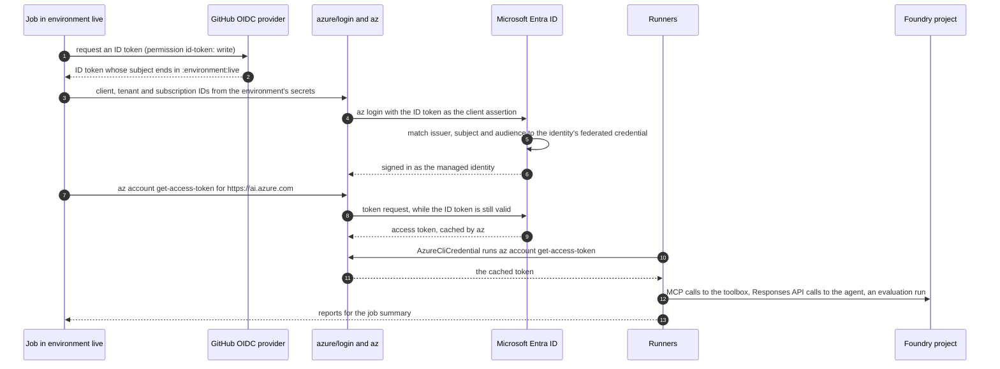

# Live runs in CI

`.github/workflows/live.yml` runs the tool tests and the deterministic agent evals against the deployed sample toolbox
and agent, then has Foundry's evaluators judge the agent's replies, every day at 12:00 UTC and on demand. It signs in to
Azure as a user-assigned managed identity with GitHub's OIDC token, so the repository stores no Azure credential. The
offline checks stay in `ci.yml` ([README](../README.md#unit-tests-and-ci)).

## 1. What a run does

| Item | Value |
| --- | --- |
| Triggers | `schedule` (daily, 12:00 UTC) and `workflow_dispatch`; one run at a time |
| Identity | A user-assigned managed identity with **Foundry User** on the Foundry resource, which the evaluators' judge calls need (the rest needs it on the project only), trusted through a federated credential for the `live` environment |
| Suites | `data/tool-tests/sample-toolbox.jsonl` (14 cases) against `sample-customer-toolbox`, then `data/agent-evals/sample-toolbox.jsonl` (12 turns) against `customer-assistant`. The agent evals run even if the tool tests fail. Then, if the agent evals recorded a run, Foundry's evaluators judge its replies by their stored response IDs, so the agent isn't called again (`evals/run_cloud_eval.py --fail-on unjudged --timeout 15`) |
| Output | The tool, agent and cloud reports from `scripts/report.py`, in the job summary. Result files stay on the runner |
| Telemetry | Spans go to App Insights with `cloud_RoleInstance` set to `github-actions-<run id>` ([telemetry.md](telemetry.md#2-configure)) |
| Status | The job fails if either suite fails, or if the evaluators can't run or can't judge a turn. The judge's failures show in the cloud report without failing the job, because on the sample suite it fails turns that are correct ([findings](../deploy/README.md#foundry-evaluator-findings)). In a step's log, exit code 1 means failed cases (for the evaluators, turns they couldn't judge) and 2 a setup error |

Not in the workflow:

- The Entra suites (`*-entra.jsonl`). OAuth identity passthrough needs a user who has consented to the connection, and
  `{{caller.*}}` placeholders need a user's claims; a managed identity has neither.
- ASSERT, which generates dozens of conversations per behavior and judges each with an LLM. Run it locally
  (`scripts/run_assert.py`).

To test another toolbox or agent, change the case files in `live.yml` and add `FOUNDRY_TOOLBOX_NAME` and
`FOUNDRY_AGENT_NAME` to its `env`; for a judge deployment other than `gpt-4-1-mini`, add
`FOUNDRY_EVAL_JUDGE_DEPLOYMENT`.

## 2. How it signs in



The runners need no CI-specific code: `evals/auth.py` uses `AzureCliCredential`, which acts as whoever `az` is signed in
as. GitHub's ID token expires within minutes, and after that `az` can't get a token for another audience. So the workflow
gets the Foundry token right after signing in; `az` caches it, and it lasts about an hour, past the job's 30-minute limit.

## 3. Set it up

You need rights to create a managed identity in a resource group and to assign roles on the Foundry resource (Owner, or
Contributor plus Role Based Access Control Administrator), and admin rights on the repository. The commands are
PowerShell; replace the values in angle brackets.

### Find your repository's OIDC subject

```powershell
gh api repos/<owner>/<repo>/actions/oidc/customization/sub
```

Use the `sub_claim_prefix` it returns. With immutable subjects (`"use_immutable_subject": true`) the prefix has the form
`repo:<owner>@<owner-id>/<repo>@<repo-id>`; otherwise it is `repo:<owner>/<repo>`. A job in the `live` environment gets
the subject `<prefix>:environment:live`, and the federated credential must match it exactly.

### Create the identity

```powershell
$rg = "<resource-group>"   # where the identity lives, for example the sample's
# <resource> as in FOUNDRY_PROJECT_ENDPOINT: https://<resource>.services.ai.azure.com/api/projects/<project>
$account = az resource list --resource-type Microsoft.CognitiveServices/accounts --query "[?name=='<resource>'].id" -o tsv
az identity create -n id-toolbox-eval-ci -g $rg
az identity federated-credential create --name github-live --identity-name id-toolbox-eval-ci -g $rg `
  --issuer https://token.actions.githubusercontent.com --audiences api://AzureADTokenExchange `
  --subject "<prefix>:environment:live"
$principal = az identity show -n id-toolbox-eval-ci -g $rg --query principalId -o tsv
az role assignment create --assignee-object-id $principal --assignee-principal-type ServicePrincipal `
  --role "Foundry User" --scope $account
```

Foundry User (formerly Azure AI User) covers the toolbox calls, the agent requests, the version reads for provenance,
registering this repo's evaluators in the project's evaluator catalog (the first live run did) and the evaluation runs.
It goes on the Foundry resource because Foundry's evaluators call the judge deployment as the
identity, and model inference needs the role on the resource: with it on the project only, every judge call fails with
`PermissionDenied` ([Learn](https://learn.microsoft.com/azure/foundry/observability/how-to/evaluation-permissions)).
Without the evaluators step, the project is enough (`--scope "$account/projects/<project>"`). The narrower built-in
roles, Foundry Agent Consumer and Foundry Project Runtime User, grant only agent-invocation data actions. Foundry User
also lets the identity read the secrets of the connections of every project in the resource, which is one reason only
`main` can use the `live` environment. A new role assignment can take a few minutes to apply, and the judge calls took
longer: an hour after the role went on the resource, 7 of 34 judge calls still failed; after two hours, none did.

### Create the environment and its secrets

```powershell
'{"deployment_branch_policy":{"protected_branches":false,"custom_branch_policies":true}}' |
  gh api -X PUT repos/<owner>/<repo>/environments/live --input -
gh api -X POST repos/<owner>/<repo>/environments/live/deployment-branch-policies -f name=main -f type=branch

az identity show -n id-toolbox-eval-ci -g $rg --query clientId -o tsv | gh secret set AZURE_CLIENT_ID --env live
az account show --query tenantId -o tsv | gh secret set AZURE_TENANT_ID --env live
az account show --query id -o tsv | gh secret set AZURE_SUBSCRIPTION_ID --env live
gh secret set FOUNDRY_PROJECT_ENDPOINT --env live                # prompts; paste the value from .env
gh secret set APPLICATIONINSIGHTS_CONNECTION_STRING --env live   # optional: without it, no spans
```

`AZURE_SUBSCRIPTION_ID` is the subscription that holds the project. The values are secrets rather than variables so that
GitHub masks them in logs, which matters in a public repository (section 4).

### Run it

```powershell
gh workflow run live.yml --ref main
gh run watch   # pick the run
```

The run's summary page shows the three reports. Once `live.yml` is on `main`, the schedule runs it daily.

## 4. Public repositories

A public repository's logs and job summaries are public.

- GitHub masks every secret's value in logs and summaries. The workflow also masks the resource and project names, which
  can appear without the rest of the endpoint, and the identity's object ID, which permission errors name.
- Result files never leave the runner: they hold the endpoint, and GitHub doesn't mask artifacts. The reports hold no
  endpoint: they name the agent, model, toolbox, versions and commit, and list case IDs, failure messages and timings.
  The cloud report adds the judge deployment, the evaluation's name and run ID, and the judge's reasons. In GitHub
  Actions the evaluators' runner leaves out the evaluation's portal link, which names the resource group.
- Forks and pull requests can't use the trust. The workflow has no pull request trigger, and the `live` environment, which
  holds the secrets and is the only subject the federated credential accepts, takes runs from `main` only.

## 5. Limits

- GitHub disables a public repository's scheduled workflows after 60 days without repository activity. Re-enable the
  workflow on the Actions tab.
- Scheduled runs can start late, or be dropped, when GitHub Actions is busy, most often at the start of an hour. Move the
  cron minute if that matters.
- Each run spends the agent's model tokens on 12 turns, and the judge's: judging the 12 turns took about 93,000 tokens in
  a local run. When the judge and the agent share a deployment, as on the sample, they share its rate limit; the job
  judges only after the agent evals end, but other runs against the deployment compete with it.
- The evaluation run took about 2.5 minutes locally. The job waits up to 15 minutes for it, then fails with exit code 2;
  the run goes on in Foundry.

## 6. Troubleshooting

| Symptom | Cause and fix |
| --- | --- |
| `AADSTS70021: No matching federated identity record found` | The token's subject doesn't match the credential's. Compare the credential with your prefix (section 3), and check that the job uses the `live` environment |
| `AADSTS700016: Application with identifier ... was not found` | `AZURE_CLIENT_ID` isn't the identity's client ID; its principal ID is a different value |
| `AADSTS700024: Client assertion is not within its valid time range` | A token for a new audience was requested after GitHub's ID token expired. Get it right after signing in, as the workflow does for `https://ai.azure.com` |
| HTTP 401 or 403 from Foundry | The role assignment hasn't applied yet, or it is on another project |
| Every turn of the Foundry evaluators errors with `PermissionDenied`: the principal lacks `Microsoft.CognitiveServices/accounts/OpenAI/deployments/chat/completions/action` | The identity has Foundry User on the project only. The evaluators call the judge deployment as the identity, which needs the role on the Foundry resource (section 3) |
| Some turns of the Foundry evaluators error with `Principal does not have access to API/Operation`, fewer on each run | The role on the Foundry resource hasn't reached every judge call yet, which took up to two hours (section 3). Re-run the workflow later |
| `Branch "<name>" is not allowed to deploy to live due to environment protection rules` | The run is not on `main` |
| Sign-in can't select the subscription | `AZURE_SUBSCRIPTION_ID` isn't the project's subscription |
| The Foundry evaluators step is skipped | The agent evals recorded no run, after a setup error; see their step's log |
| `the evaluation run is still <status> after 15 minutes` | Foundry hadn't finished judging. The run goes on there; look for other load on the judge deployment, then re-run the workflow |
